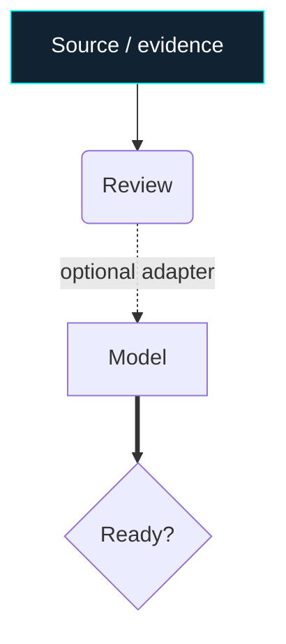

# Terminal-native documents

## Browser diagrams: official Mermaid SVG

The optional experimental `@ubernaut/exotui/mermaid` entrypoint now also exports `MermaidSvgFlexSurface` and
`MermaidSvgDesktopLayer`. They keep the existing ExotUI Markdown/flex components and scrolling document, but reserve
diagram stages for the pinned upstream Mermaid 12.1.0 SVG instead of approximating its SVG/CSS/MathML in terminal cells.
All 57 catalogue examples mount as actual SVG in the browser probe. `MermaidSvgMarkdownController` is available for
single-panel integrations. This delegates diagram features to upstream; it is not a claim of complete native-cell
feature parity. Earlier native-fidelity notes below are historical work and optional fallback capabilities.

Create one borrowed compiler with `createMermaidStandardRenderer({ document })`, then construct a surface with
`new MermaidSvgFlexSurface(compiler, { sections, render, onLink })`. `surface.settled(width)` waits for current diagram
heights. `configure({ config, cellWidth, cellHeight })` supplies a host theme/aspect ratio; source cannot enable trusted
callbacks. Default cells are 9×18 CSS pixels. SVG aspect comes from its viewBox, with a measured upstream viewport for
families such as `info` that omit it. Small diagrams are not enlarged beyond their intrinsic size.

The browser host calls `layer.present({ windows, documents, columns, rows, blocked })` after desktop composition.
`documents` maps window IDs to `{ surface, width, height, column, row }`; insets are relative to each client. Final
back-to-front window rectangles clip diagrams, including higher windows' chrome. Hide stages while menus, modals or
detached window transitions own the picture. The shared desktop supplies its transition status to `onWindows` as the
fourth argument. Source/width changes abort owned work and reject stale results; theme changes retain the last accepted
height while replacements load. Disposing the layer/surface never disposes the borrowed compiler.

Each stage uses Shadow DOM to contain IDs/styles without iframe history entries. Strict upstream source policy plus
inert-template mounting removes source scripts/event handlers and denies external stage resources; stylesheet rules are
parsed by the browser before resource checks. This is not a hostile-input sandbox for upstream compilation itself. Real
text selection uses the browser host's `data-exotui-selectable` boundary; `selectionText` feeds that selection into the
shared desktop's existing context Copy action. No source callbacks/global functions are executed.

Browser tradeoffs are explicit: SVG stays crisp and is not warped by the canvas CRT shaders. Occluded SVG regions are
clipped rather than sampled into the cell-based glass compositor; existing cell-window glass/shaders still work.
Terminal/circuit renderers remain optional fallbacks. Tech-stack defaults to SVG and offers `?diagrams=circuit`.

Run `deno task mermaid:test:svg` for the catalogue, stale-resize, theme/disposal, CSS isolation, script/resource and
history probes. The optional engine stays out of the core/default desktop dependency graph.

The optional `@ubernaut/exotui/document` surface extends the existing Markdown component. Default rendering is
unchanged; enable heading fonts and Mermaid fences explicitly:

Run `deno task document-viewer` for the interactive terminal fixture, or pass a Markdown path to inspect a real guide.
For example: `deno task document-viewer ../tech-stack/docs/downloads/ecosystem.md`. This is the maintainer's
real-terminal review path; use Q to quit.

```ts
import { ASCII_HEADING_FONTS, Markdown } from "@ubernaut/exotui/document";

const document = new Markdown({
  parent: tui,
  rectangle: { column: 0, row: 0, width: 80, height: 24 },
  zIndex: 1,
  theme: { base: (text) => text },
  source: markdown,
  render: { headingFonts: ASCII_HEADING_FONTS, mermaid: true, showLinkDestinations: false },
  onLink: (href) => openDocument(href),
});
```

The existing controller owns wrapping, table layout, caching, wheel/key scrolling, viewport inspection, and link hit
testing. Table cells are truncated to one row by default. `render: { tableCells: "wrap" }` keeps every cell complete:
cells wrap onto extra rows with their inline marks and links, body rows that wrap are separated by rules, and a table
too narrow for its longest words (or with a column squeezed below eight cells) becomes labelled records, one per body
row. Plain (non-art) headings wrap between words; only a word wider than the row splits between glyphs. Applications
decide what link protocols mean; the renderer never opens URLs or executes callbacks named in content. Markdown HTML is
disabled by the parser. The built-in `mermaid: true` option is a deliberately bounded flowchart subset. The separate
full engine below supplies prepared cells without changing that default.

## Full Mermaid standard — in development

The current ink-ownership revision passes complete browser/headless conformance and all53independently audited health
gates (4131root tests,559Exomux,63web,54workers/87benchmarks) on unchanged final source. It preserves all original
diagram/math/source assertions and adds600pixel cases/3600repaints plus48actual disposed-MathML browser profiles. The
default desktop is rebuilt; the tech-stack preview remains on its unchanged consumer build. Full Mermaid acceptance and
consumer migration remain unfinished.

The shared browser cell sink now clips actual glyph ink to its owned native span, without guessing from character
advance or changing logical font anchors. Rounded device-pixel partitions prevent fractional-scale clearing trails and
paint-order dependence; circuit/block geometry shares the same owned plane without full-block seams. Decorations are
clipped as ink too. Pixel regressions cover odd cell widths, five display scales, basic font styles and sparse
scroll/clear updates; actual compiler-disposed MathML documents also traverse the native/remote cell path. This does not
establish exact font-outline/shaping parity or completion of the full Mermaid standard.

MathML fraction bars now retain the browser-resolved thickness and math axis, including percentages, relative units,
invalid-value fallback and zero/negative suppression. A bounded inert probe borrows host fonts and is removed after
capture, including refusal; original diagram styles/callbacks are not cloned. Existing affine stroke metrics retain
screen-pixel thickness through SVG scaling and native JSON transport. Ordinary math glyph density also preserves visible
denominators near clip edges. Radical rule thickness, full font outlines and broader math parity remain open.

ForeignObject clipping retains its original affine viewport. Detached zero-advance MathML fragments now carry optional
ready-font ink boxes independently of empty advance anchors. A shared unregistered1x1 canvas measures
[actual font ink](https://html.spec.whatwg.org/multipage/canvas.html#textmetrics), preserving logical text/NBSP
carriers. Native projection refines automatic density across clip/ink bounds and chooses surviving silhouette samples if
the ink centroid is clipped. Conservative bounds never bypass actual clipping; all walks share the native work quota.
Malformed/overflow/degenerate boxes, clip cycles and excessive allocation are rejected. Basic font styles, viewBox, zoom
and axis-aligned transforms have original-pixel controls; other font/transform variants remain diagnosed. The unchanged
old ink/link assertion,32original before/after controls,32DOM/96snapshots and41actual diagrams/656disposed snapshots
pass targeted checks. Complete browser/headless/53audited health gates, fonts/counters/types/lint/73focused and package/
release checks pass on1468unchanged inputs. This remains Unicode projection, not exact outlines/shaping. Actual Canvas
overhang can persist after a carrier's owner cell clears; fix that repaint boundary next. All original full-standard
acceptance gates remain open. Default/consumer previews are unchanged.

Math operator assemblies now use the original operator's position/extent and measured mirrored glyph ink, preserving
logical text through native JSON/document transport. Short fallback fences/accents are not enlarged to their parent's
height or base width. Zero-advance vector accents retain logical U+20D7 with a portable arrow carrier at the styled
font's ink extent, measured in a lazy unregistered1x1 canvas; unavailable metrics explicitly diagnose the fallback.
Assembly metadata is a native Unicode projection hint, not a claim of physical OpenType stretching or exact outlines.
Automatic density retains top/body/bottom fence pieces inside the original box; old matrix assertions remain intact.
Fifteen original fence pixel controls/six accent controls,144direct cases/300snapshots and12real diagrams/192disposed
snapshots pass. Complete browser/headless, all53 audited health gates, types/lint/fonts/counters and30focused checks
pass on unchanged1467-input source; default/consumer artifacts are unchanged. Next retain authored fraction-rule
thickness:20original pixel controls prove eight4px/8px bars captured as1px. Broader structural/font/family/feature/
capability/consumer/review acceptance remains open. Earlier receipts below belong to their stated source revisions.

The RTL-radical correction passes complete browser/headless runs, all 53 health gates, font/counter checks and 29 narrow
tests on unchanged source. Original delimiter pixels prove RTL assembly mirroring and fallback-height defects as the
next corrections. Exact font/structural/stretch fidelity and the full feature/capability/consumer/review acceptance
audit remain unfinished. Earlier verification receipts below belong to their stated revisions.

LTR/RTL square and indexed MathML roots retain measured radical placement and operand overbar extents; the degree is not
included in the bar. Surds paint after the base's fraction rules so quantized boundary cells cannot replace them.
Independent original Chromium pixels preserve the same U+221A shape in both directions, rather than inventing a
reflection. Two fonts, inherited/local directions and plain/indexed/fraction/multi-child/nested roots have 48 direct
cases/144 snapshots; six actual Mermaid math diagrams survive disposal through 96 native snapshots with source, style,
links and notation intact. Exact math font outlines and broader structural/stretch ordering remain unfinished.

Horizontal unstretched MathML `mi`, `mn`, `mo`, `ms` and `mtext` tokens now use original glyph positions when text is
reordered or mirrored, rather than assuming an LTR parent implies LTR ink. Ordinary monotonic tokens keep their existing
math baseline/ink-box path; stretched operators keep their assembly path. Overlapping original line boxes distinguish
actual same-line reversal from separate legacy rows, preserving existing logical spaces. Token sequences, styles, links,
source text and the shared scene character budget remain intact. Thirty direct cases/two fonts/90density snapshots
independently check scalar positions and an authored zero-size math baseline marker; fifteen real diagrams survive
compiler disposal/native transport. Supported horizontal tokens no longer receive a false generic RTL warning;
structural/stretched RTL retains it. Current Chromium forces authored vertical MathML tokens horizontal, which is not
native vertical capability evidence. Complete browser/headless checks, all53health gates,701focused tests and font/
counter/private-peer checks pass on independently rediscovered unchanged source. The subsequent radical correction above
restores the reproduced RTL notation loss; structural/stretch ordering, general native font/legacy shaping and every
full-standard acceptance requirement remain open. These receipts are not full completion/publication.

Ordinary length-changing HTML casing no longer emits a shaping warning merely because an optional layout pass was
prepared. A warning is retained when an actual split label lacks required positioned glyphs, including expanded casing
inside that same label. Separate labels do not acquire each other's layout requirements.

Plain combining/control-bearing MathML tokens and separately measured generated text now retain optional rendered ink
and displaced fragments. Original token baselines, styles, links and source text remain intact. Token-local sequences
are mapped to unique scene-local sequences; positioned MathML shares the scene's 65,536-character budget with HTML/SVG
labels. Twenty original-DOM cases across two fonts and three densities, ten real Mermaid compiles and disposed native
document transport cover this profile, not complete MathML bidi ordering or exact font shaping. The subsequent
token-order continuation above corrects original-DOM-proven implicit-RTL and explicit-override ink. The casing/cluster
revision passes both full compiler hosts, all 53 health gates, 701 focused tests and font/counter/private-peer checks on
independently rediscovered unchanged source. These are regression receipts, not full-standard completion. The completed
split-cluster receipts below belong to the preceding revision.

The split-cluster revision passes complete browser/headless conformance, all53health gates,701focused tests,
font/counter/private-peer checks and package/release dry runs on independently rediscovered unchanged source. This is
revision-specific regression evidence, not full-standard completion or publication; all ten task050 gates remain open.

Combining marks that the browser positions separately from their logical bracket grapheme now retain independent inert
ink fragments. Original scalar boxes determine bracket mirroring and position; the whole-grapheme union cannot move the
bracket into a floating mark's run. HTML fragments use top-left anchors and SVG fragments retain measured centers. All
runs in a split HTML label share a scene-local sequence; ordinary labels retain their existing placement. Automatic
density checks visual row/column order across each label, not merely neighboring source characters. This prevents
displaced mark carriers from silently overwriting unrelated Hebrew/Arabic glyphs. The bounded sweep permits 65,536
painted glyphs and sixteen refinements; explicit coarse density still diagnoses overlap.

Zero-advance marks use an inert NBSP carrier with a preceding-cell offset. Native cells preserve the bracket and mark,
but this is not exact font shaping or an independently styled glyph-overlay engine; an explicit diagnostic records that
host capability gap. Multi-base graphemes such as Indic conjuncts and emoji, and variation-selector groups, stay intact.
Shared-box advancing marks, length-changing casing of split clusters, other MathML bidi/shaping contexts, advanced bidi
controls, font-only mirrors and final feature/consumer/review requirements remain unfinished. Independent
original-bracket interior pixels establish mirrored base ink, not the full combining mark's outline or overhang.

Ambiguous HTML bracket direction uses a lazy, bounded, text-only measuring document that retains original bidi scopes
and splits only private text nodes. This fixes preserved-tab/Arabic-digit labels without mutating author text or the
application's selection/focus. Direct original measurements and native geometry are unchanged. Exact glyph-pixel,
disposed compiler/Markdown/native regressions and complete browser/headless/53-gate health checks pass; broader advanced
shaping, font-only mirrors and full-standard feature/consumer/review requirements remain unfinished.

The current ordinary-SVG-anchor revision passes both complete conformance hosts, all53health gates under the
color-enabled test profile, font/counter/peer checks and package/release dry runs. The initial color-disabled ANSI test
failures reproduce on the clean baseline; no renderer code or assertion is changed to bypass them. Frozen source,
default desktop and consumer artifacts remain unchanged after verification. These checks are not full-standard
completion or publication; advanced text/fidelity/capability/consumer/review work remains.

Mirrored glyph substitution preserves ordinary SVG run placement through optional renderedText; it does not force
center-positioned layout or move a lone character to a different native row. Truly irregular geometry retains per-glyph
ink. Equal-browser-bounds controls verify exact native cells/styles/links at three densities, and real compiler tests
include all six single-character parentheses/brackets/angles in both HTML and SVG. Full control-code/font shaping
remains unfinished; sampled original Chromium pixels do not certify exhaustive Unicode conformance.

The preceding glyph-ink revision passes both complete conformance hosts, all53health gates and package/release dry runs.
Advanced control-code/caret and font-shaping contexts remain unresolved; the passing examples and paired Unicode
substitutions are not a claim of full bidirectional conformance. Nothing is published or switched in the default
desktop/consumer builds.

Measured bidi glyphs now retain logical text separately from native paint. Paired Unicode17 mirrors use SVG character
advance or consistent HTML caret evidence; mixed-direction spans are not reversed as a whole. Optional
renderedText/per-glyph ink survives JSON and ordinary Markdown paint. Font-only mirrors and ambiguous geometry are
diagnosed; exhaustive bidi/CSS/font shaping remains unfinished. The offline generator is
`deno run --allow-read scripts/update_mermaid_bidi.ts --check`; it verifies pinned source and generated data.

Current context/viewport fixes pass complete browser/headless conformance, all53health gates and package/ release dry
runs. These revision-specific checks do not establish full-standard completion or a published release; the default
desktop/consumer builds are unchanged.

Measured parentheses/brackets/angles now paint the browser-resolved paired mirrors without rewriting logical text.
Complete bidi glyph projection, ambiguous contexts and shaping remain unfinished; geometry/parse checks alone do not
establish full text fidelity.

Prepared full diagrams expose host-controlled horizontal offsets. A narrow viewport can leave valid decorated labels
offscreen, as in Kanban's ticket columns; hosts may pan and invalidate their Markdown model without recompiling
geometry. Tests verify panned mounted ink and restore the original narrow left view.

The filter working grid's allocation, numeric precision, cyclic-clip rejection and raster/filter costs retain explicit
guards. Clip-bound traversal charges node, child and point visits before walking; bounded per-call reuse prevents
repeated shared region/domain walks. Actual read-count and pre-walk budget tests cover these metadata costs without
relaxing existing graph, clip, retained-cell or total-work limits.

The optional compiler uses pinned official Mermaid 12.1.0 grammar/layout and feeds measured scenes into native ExotUI
components. Full-standard feature fidelity and consumer integration remain in development.

### Shapes, looks and themes

Both complete conformance hosts also validate proper-header malformed bodies/contexts for all 38 registered parsers:
original diagnostics survive rejection, then a valid request compiles into visible JSON/native cells. These are
negative/recovery cases, not exhaustive per-family feature or pixel-fidelity evidence. Timeline preserves upstream's
event-without-period TypeError rather than inventing a syntax diagnostic.

The default optional compiler now lazily registers @mermaid-js/mermaid-zenuml@1.0.1 with @zenuml/core@3.50.1; neither
loads in the lightweight core. Registration is queued once per shared runtime. The extension's no-op parser is wrapped
with core's exact generated ANTLR grammar and pinned 4.11.0 runtime, without constructing a React viewer or portal. All
sixteen pinned syntax examples join the original 39-example catalogue. ZenUML's ignored common accessibility preamble
uses the existing bounded, inert metadata adapter; its body syntax remains upstream-owned.

The SDK public parse method retains a private error list across rejected requests. Validation therefore runs in one
owned module worker per uncached source; worker termination and script-URL revocation release its parser/DFA/error realm
on success, rejection, cancellation, disposal, startup failure or a 30-second timeout. Only successful source strings
are cached (ten entries, no AST/error graphs); the existing 128,000-character source limit remains. Main-realm SVG
rendering sees validated input. A reproducible development generator verifies the published source-map and all three
unchanged grammar hashes and retains the MIT/BSD notices; it has no runtime network or sibling-checkout dependency.
Hosts need module workers and permission for owned `blob:` worker scripts; denied capability fails explicitly. This does
not claim that all SDK/browser layout memory is bounded or clear a separately imported host SDK's own errors.

Core also injects an 893,447-byte legacy viewer stylesheet on first import. The loader observes only new head style
nodes and removes only the exact pinned SHA-256 match, preserving existing SDK/host styles and same-sized unrelated
styles. Lazy pure-JS hashing supports insecure local HTTP as well as HTTPS; DOM globals and CSS limits stay unchanged.
The SVG renderer's own local styles remain authoritative. Borrowed legacy styles still count against normal host
stylesheet limits; this is not permission to purge or exempt arbitrary host CSS.

Root SVG clipping is measured through a cleaned-up viewBox-free sibling, including meet letterboxes and CSS transforms.
Native text clipped by the real viewport does not report a false frame-bounds warning. ZenUML's long reply comment
really exceeds its 363.5x457 upstream viewport; the full text/source is retained while paint follows the original
browser clip. This does not repair upstream's comment layout by changing dimensions. Full feature/fidelity,
security/lifecycle, consumer and review acceptance remain unfinished; current broad verification is recorded in
task 050.

The pinned general-purpose registry has executable native checks for 53 canonical shapes in `classic`, `neo` and
`handDrawn`, plus 87 shape aliases in classic. Eleven themes are checked with both SVG and HTML labels, authored class
paint, Markdown emphasis, subgraphs and accessibility source metadata. Special icon/image shapes use separate asset
fixtures. These checks are not exhaustive syntax, layout or accessibility support.

Hand-drawn cubic/quadratic hatch contours now use adaptive control-hull geometry with browser-measured partial-curve
distances. Near-straight strokes no longer exceed the point budget simply because they are long. Native tracing uses
unsnapped cell intersections and actual segment directions, keeping dash phase and hatch glyphs without converting them
to grids of box corners. Existing source/point/work limits still apply. Native circuit glyphs do not yet recreate
pixel-exact SVG stroke-width/cap/join outlines, and visual review remains required.

### Text decoration

Measured scenes retain bounded decorating-box underline/strike/overline descriptors, independently of glyph ink and
computed inheritance. A descendant's `none` does not remove an ancestor's line; atomic-inline and out-of-flow boxes
start a new decorating context. SVG stores the decorating owner's fill/stroke alongside its original computed CSS color,
while rendered HTML/CSS labels use the CSS decoration color even when the decorating owner is an SVG ancestor. Separate
per-extraction projections preserve original SVG descriptors and do not mutate mixed SVG/HTML siblings. Existing
owner/layer/metadata limits bound the caches. The pinned full Kanban example now captures black ticket underlines
without inactive white SVG fill/purple stroke, matching original source ink rather than hiding warnings. Exact geometry
and other advanced decoration paint remain unfinished. Local-use and marker transfers preserve their already captured
text data, and text clip/paint samples use cell centers rather than rejecting visible labels through snapped origins.

Underlines carry independent ink and solid/double/wavy/dotted/dashed terminal styles; solid same-ink overline and
strikethrough also use native cell/ANSI styles, not added label characters. The ordinary Markdown and flex components
preserve those styles through wheel/reflow/pan/clipping, JSON and compiler disposal; plain-text copy remains unstyled.
The shared browser canvas sink honors italic/underline/strike/overline SGR, including atomic colon subparameters,
RGB/indexed underline colors, sequential resets, bounded whitespace lines, font-aware measurement caching and repaint
cleanup. RGB zero channels never clear existing style. Underline patterns use screen-coordinate phase so isolated dirty
cells repaint continuously. Explicit underline ink survives inverse, while default ink follows the reversed foreground.
These are conventional cell geometry, not pixel-exact CSS metrics. Upstream SVG class abstract members explicitly set
inner spans to normal; capture preserves that leaf style instead of forcing a parent's italic.

This is partial decoration support: multiple distinct layers, independently colored/non-solid strike/overline,
stroked/transparent/filter/group paint for independent ink, custom thickness/offset/position/skip-ink, exact geometry
and all other required typography remain unfinished and diagnosed. Browser wide glyphs now paint atomic two-cell spans
when their present continuation has empty parsed text, including styled empty cells. Either dirty half repaints the
pair; owner replacement clears old tails and resize drops retained state. Ordinary spaces/missing followers do not grant
spans, right-edge wide glyphs are omitted whole, and oversized narrow advances remain clipped. Grids retain at most
2,000,000 finite cells; refused resize leaves prior geometry/state intact. Extended terminal support is host-dependent;
terminal capability detection/degradation remains a full-standard requirement. A green family catalogue does not prove
every native style. Nested TerminalScreen and Exomux now carry italic/faint, underline style/ink, overline and strike
through atomic SGR parsing, model snapshots, styled scrollback and their paint caches. Shared plain/styled text helpers,
width and cropping now reuse the existing pinned Unicode 17 UAX #29 segmenter, retaining long combining sequences, Indic
conjuncts, Hangul and emoji clusters. SGR changes do not create grapheme boundaries. A cell retains its first scalar's
style; internal SGR changes update following cells rather than painting independently styled subglyphs. Incremental
terminal joins preserve the same tested clusters across UTF-8/UTF-16/SGR splits and repair width changes, continuations,
insertion, REP and margin wrapping/clipping. A constant-space boundary/width cursor now preserves up to 65,536 UTF-16
units per terminal cell without rescanning each growing cluster, even in insert mode. The model budgets at most
8,388,608 extra units above two units per stored cell across main/alternate/history rows; controller options
`maxGlyphUtf16Units` and `maxRetainedGlyphExtraUtf16Units` can lower these limits. Overflow visibly replaces the whole
cluster with U+FFFD, consumes the remaining joining scalars and increments `inspectGlyphs().rejectedClusters`, rather
than retaining a truncated prefix. Erasure, shifts, scrollback trimming, screen changes and resizing release the exact
stored extra units. Bounded last-glyph/context references and one unplaced zero-prefix cluster, each limited to the
per-cell budget, and borrowed input/caller snapshots are separate; this does not bound grid/style/decoder/font/shaping
memory. Zero-only nonspacing and format marks now use the complete assigned zero-width projection of the pinned narrow
profile (2,533 scalars), not five hard-coded mark blocks. Standalone zero-only marks at the start of a terminal line are
held without paint, then omitted if no joining visible scalar arrives. A following visible spacing mark paints the
complete cluster with its first scalar's style. Prepend/spacing marks and unassigned control holes are not silently
equated with zero cells. Legacy standalone emoji-modifier tailoring, full Unicode width policy, arbitrary shaping and
terminal capability detection remain separate. The compact projection is generated from reviewed full width data and
checked offline by `deno task unicode-data:check`. Native wide-pair repair also handles ASCII-base keycaps, rather than
silently discarding their continuation cells. Reverse video follows resolved grounds without reversing explicit
underline ink; cursor and inactive-pane colors retain typography. The opaque remote style palette keeps style keys
opaque. This transport fix does not establish host capability detection, complete CSS geometry or complete font-metric
fidelity. Generic remote codec v2 preserves empty wide followers and multi-code-point cells; v1 cannot represent those
cells and explicitly rejects them. Raw ANSI/PTY transport is separate. See
[decorating-box propagation](https://www.w3.org/TR/css-text-decor-3/#line-decoration),
[SVG decoration paint](https://www.w3.org/TR/SVG2/text.html#TextDecoration), and
[Chromium's SVG decorating-owner paint](https://chromium.googlesource.com/chromium/src/+/3bbce24997c008ef45d4253542ec7f0a5a97e571/third_party/blink/renderer/core/paint/text_painter.cc),
[terminal underline transport](https://sw.kovidgoyal.net/kitty/underlines/), and
[terminal overline/color/subparameter controls](https://xtermjs.org/docs/api/vtfeatures/).

### Native input and explicit cell boundaries

The default display scalar policy now projects both complete assigned zero-width categories and Unicode 17 W/F widths
from the reviewed narrow profile. Combining/fixed-zero categories take precedence; ambiguous, private-use and unassigned
scalars otherwise occupy one cell. Isolated regional indicators retain two cells and emoji modifiers zero as explicit
presentation tailoring. The generated 130-range W/F projection avoids importing the full width registry into the default
desktop. Offline checks and all 1,112,064 Unicode scalar values independently verify the policy. This changes previously
incorrect wide-symbol/script spans and overly broad unassigned/symbol spans. Existing crop behavior still pads a clipped
wide half with one space. Host-selected profiles, font shaping, variation-sequence and capability negotiation remain
required work; scalar agreement is not a terminal-shaping claim. See
[Unicode 17 width and terminal tailoring](https://www.unicode.org/reports/tr11/tr11-44.html).

ANSI range compaction parses complete color parameters atomically before omitting a reset. Combined bold/italic/
decoration attributes do not leak into subsequent independent cells; RGB channels and colon groups are never mistaken
for separate attributes. Pure color-only spans retain their compact form. Disposed Mermaid compiler fixtures now compare
both actual addressed sink paths with every original glyph/style cell, in addition to the original raw text, remote and
browser pixel oracles.

`TerminalScreenController.write` consumes incremental UTF-8 bytes or UTF-16 strings. A string chunk's final high
surrogate is held in a one-unit buffer until the next decoded scalar; empty chunks and viewport changes do not split it.
Call `flushInput()` at end of input to emit an isolated final high surrogate or flush incomplete UTF-8 as U+FFFD. The
flush is idempotent without further input and does not close the screen. `clear()` discards pending decoder input.
Controls between surrogate halves keep them separate, while SGR between complete scalars still preserves first-scalar
grapheme styling.

The ANSI canvas sink retains explicit non-ASCII cell positions instead of concatenating independent glyphs into a
potentially different grapheme. Absolute cursor addressing brackets Unicode cells, retaining empty wide followers and
compact printable-ASCII spans. The screen model honors these addressing boundaries even for leading zero-width marks;
SGR alone does not end a cluster. Mounted independent TextObjects and both sink paths are checked through real UTF-8
writes. Arbitrary raw ANSI concatenation still has no authored cell metadata: a padding space followed by combining
marks can legitimately be one text cluster. Exact portable cell transport uses the sink or negotiated cell codec; real
terminal shaping/capability behavior remains host-dependent, not certified by the model tests.

### Newline compatibility

The shared pre-1.0 text helpers also treat CRLF as one line-ending grapheme: first-line width excludes the ending, and
cropping omits both CR and LF. This corrects the historical dangling-CR Textbox visual prefix while retaining original
UTF-16 source offsets.

ASCII control scalars now have zero display width too. Textbox's visual wrapping retains literal UTF-16 source offsets
while admitting those zero-width units; its separately space-rendered tabs still count as one column. Intrinsic layout
likewise maps authoring tabs to one space before measuring/wrapping; raw `textWidth` still gives tabs zero width. This
is not an ANSI-aware source-editor lexer, so a raw editor string can still split a CSI command across visual rows. The
historical wrapping fixture remains immutable: only its named CRLF and zero-control cases have separately pinned
semantic changes.

### Remote explicit cells and compatibility

Experimental `./remote` defaults locally to codec v2. A styled run carries one UTF-16 length per cell, including zero
for empty wide followers: `["AB", ""]` is distinct from `["A", "B"]`, even when concatenated text is identical.
Arbitrary cell strings are not segmented, normalized or width-guessed in transit. v2 uses field-length-prefixed FNV-1a
and separate delta base/result checksums; these are integrity checks, not authentication or collision-resistant hashes.

Before network traffic, advertise `FRAME_CODEC_CAPABILITY` through the existing strict `RemoteCapabilityHandshake`
manifest and wait for `ready`. `negotiatedFrameCodecVersion(ready.negotiated)` selects 2 only from the agreed capability
intersection; otherwise choose 1 in encoder options or `FrameFlowOptions.codecVersion`. Make the capability mandatory
when the application requires compound/empty cells: old peers then reject at handshake time, before frame traffic. The
handshake schema/protocol and raw ANSI/PTY transports are unchanged.

Both decoders accept validated v1/v2 payloads. v1 emission has the original shape/checksum and permits exactly one
JavaScript string-iterator item per cell, but rejects empty followers and multi-scalar clusters with typed
`legacy-cell`. It never silently guesses or strips those cells. Opaque styles, including SGR bytes, remain exact in both
versions.

Adjacent lone high/low surrogates use separate same-style runs, including across row boundaries, so an old decoder
cannot merge the original cells. This corrects run partitioning for a case the old encoder could not represent exactly;
an additional actual new-host/old-client compatibility scenario verifies full/delta/coalescing/resize/resync/reconnect.

`snapshotCellFrame` detaches and freezes frames; flow owns in-flight/coalesced snapshots without freezing caller data.
Resync clears stale pending state. Windows are integers 1–64, and invalid/future ACKs cannot mutate the delivery chain.
Malformed payloads, getters, sparse arrays, unsupported versions, invalid lengths/palettes, row-crossing/overlapping
spans and checksum failures produce bounded resync results, not partial paints. Data getters are not invoked; proxy
reflection traps may execute and their errors are caught. Hosts still own incoming JSON byte limits and authorization.

`FRAME_CODEC_LIMITS` caps a frame at 1,000,000 cells, 65,536 UTF-16 units per cell, 8,388,608 text units, 4,096 units
per style, 65,536 palette entries and 4,194,304 aggregate unique-style units. Aggregate delta results include unchanged
base cells in those bounds. These are explicit typed-data bounds, not browser/terminal shaping or wire parsing limits.

`scripts/remote_frame_compatibility.ts /absolute/old-checkout full-pinned-sha` verifies clean pinned old/new modules in
separate private loopback peer processes. Both directions cover negotiated v1 full/delta, coalescing, resize,
corruption/ resync and reconnect; new/new Unicode uses v2, and required capabilities reject old peers before frames.
Real disposed Mermaid fixtures additionally compare every original Markdown cell/ANSI byte through JSON full/delta
transport before nested terminal and browser pixel checks. No check touches live Exomux PTYs or certifies all Mermaid
features.

### Native animation

Official flowchart edge IDs support `e1@{ animate: true }`, `e1@{ animation: fast }` and `e1@{ animation: slow }`, as
well as class-defined dash animation. Mounted upstream keyframes become portable `MermaidScene.animations`, not a
replacement Mermaid/CSS parser. Native playback uses measured local stroke distances, pathLength calibration and
phase-dependent cell coverage. SVG path fill/stroke opacity and element/group opacity also have numeric tracks. Explicit
native paint now survives semantic link styling while keeping link emphasis/activation.

```ts
import { MermaidMarkdownCache, MermaidMarkdownController } from "@ubernaut/exotui/mermaid";
import { Signal } from "@ubernaut/exotui";

const time = new Signal(0); // the host owns ticks, pause, frame rate and reduced motion
const cache = new MermaidMarkdownCache(renderer);
const controller = new MermaidMarkdownController(cache, {
  source: markdown,
  time,
  settings: { native: { background: "rgb(10,12,20)" } },
});
await controller.settled();
time.value = 125; // repaint existing geometry; no new compiler/cache jobs
```

`MermaidFlexMarkdownController/Surface` accepts the same borrowed `time` signal for all panels. Disposing a document
unsubscribes but does not destroy that signal. Standalone `renderMermaidNativeFrame(scene, { timeMs })` and
`projectMermaidScene(scene, timeMs)` are pure and work after JSON transport/compiler disposal. Preparation can use a
`time: () => number` reader; ordinary Markdown hosts must invalidate their controller on ticks. Prepared `.native`
frames describe the initial snapshot; the document render hook projects subsequent times. With no clock/time option, the
native frame is deterministically at zero, suitable for reduced motion. No hidden timers are created.

Tracks retain delay/end delay, fractional/zero/infinite repeats, iteration start, four playback directions, fill,
authored pause, CSS cubic-bezier/keyword/step easing and per-keyframe intervals. Capture restores keyframes on success
and failure. Limits: 512 effects/tracks, 128 frames per track, 8192 frames per scene, bounded numeric/easing fields.
Infinity is represented as `"infinite"` in JSON. Unsupported transforms/geometry/colors/dash-array animation, SMIL,
inherited animated path paint, coupled property stacks, additive/accumulated effects, non-unit playback rates,
pseudo-elements and newer unsupported easing functions remain diagnosed; full animation parity is not claimed.

Set `EXOTUI_CHROMIUM` to an existing Chromium executable, then run
`deno task mermaid:document-viewer --animate --no-chromium-sandbox` for actual terminal review when the host explicitly
permits unsandboxed Chromium, or omit the sandbox flag on a supported host. The viewer disposes the compiler before
optional host-clock playback. Browser/headless conformance verifies six official examples and retained scenes; the
independent Chromium oracle currently checks 26 timing cases/468 samples plus opacity, source restoration, paused
capture, failure cleanup and unsupported geometry/stack diagnostics. Cell paint checks do not replace a maintainer's
real-terminal/true-color review.

### Engine and native conversion

The experimental optional `@ubernaut/exotui/mermaid` surface now delegates grammar, configuration and SVG layout to
official Mermaid **12.1.0**, rather than extending the bounded flowchart parser into a second implementation. It is not
imported by the core or existing document entrypoints. `createMermaidStandardRenderer()` uses an actual browser DOM to
compile; `diagramTypes()` reads upstream's registered catalogue. Parsing also needs a DOM because some upstream grammars
sanitize HTML labels during parsing. The separate optional headless adapter below supplies an actual DOM to Deno hosts;
neither path installs fake browser globals into the application's process.

```ts
import { createMermaidStandardRenderer, renderMermaidNativeFrame } from "@ubernaut/exotui/mermaid";

const renderer = await createMermaidStandardRenderer();
const diagram = await renderer.compile("sequenceDiagram\nAlice->>Bob: Hello");
const cells = renderMermaidNativeFrame(diagram.scene!);
```

Compilation runs offscreen for accurate SVG/HTML-label measurements, then releases the DOM tree. SVG is retained as the
authoritative export; measured vectors, native text runs, styles and links form a serializable scene. Native conversion
shares circuit line glyphs and existing raster geometry, retains thick/dashed distinctions and real Unicode labels, and
preserves resolved color/emphasis. Compound contours keep separate strokes and nonzero/evenodd fill holes. Vertex
markers expand through real SVG transforms, and wrapped HTML labels are measured per visual line. Reactive Markdown and
flex panels request upstream layout at their actual content widths; intrinsically large diagrams keep readable density
and pan/clip rather than squeeze labels. Zero dash arrays correctly stay solid. Dash lengths and offsets now use
measured local SVG arclength, odd-array repetition, per-contour phase resets, author `pathLength` calibration and
DOM-resolved lengths/percentages. Clipping does not reset the phase. Upstream arrowhead-gap patterns no longer turn the
entire solid arrow dotted; cell-scale mixed coverage uses the dashed glyphs. Zero-length dashes paint dots only with
round/square caps, and overlapping caps can become solid. Thin strokes retain circuit glyph projection. Wide native
outlines now retain transformed width/cap/join geometry and host-space non-scaling metrics as described below; complete
curve/advanced stroke equivalence still needs fidelity work. Native conversion also bounds total scene work across path
sampling, fills and dash projection, so many overlapping paths or long patterns cannot evade the frame/point budgets.
Exceeding a budget rejects; it does not paint source text as a substitute.

### Native SVG stroke outlines

Paths retain a portable authored-space `strokeInverse`, resolved `lineJoin` and `miterLimit`. Wide strokes union bounded
segment bodies, butt/round/square caps, miter/round/bevel joins and dashed runs before painting each native sample once.
This avoids multiplying alpha where bodies/caps/joins overlap. Affine metrics preserve anisotropic, reflected and skewed
widths, not an isotropic guess from scene centerlines. Closed contours join their seam; disconnected contours reset dash
phase. A positive dash starting exactly at the path endpoint does not invent a capped dot. Actual zero-length path/line
round/square marks survive capture; butt marks and singular-transform strokes remain invisible.

At widths below one native cell the existing circuit glyphs retain a useful minimum footprint; wider sampled silhouettes
use native full-block foreground cells, existing clip/gradient/compositor rules and host-controlled action metadata.
This is a terminal adaptation, not pixel-identical font/glyph rasterization. Curves use the existing bounded flattened
geometry. Pure portable `miter-clip` geometry has regressions, but the current upstream browser does not supply that
style in the source fixture set; do not infer universal SVG2 support from a pure case. Arc joins, text-outline paint
order, full curve-outline/error evidence and sub-cell animation remain work in task 050.

Non-scaling strokes use `strokeInverse` to map scene samples into host CSS pixels, and separate `strokeDistances` per
contour for their dash phase. Authored `point.distance` is preserved; nonuniform/skewed curve lengths are not replaced
by an isotropic scale estimate. Curve sampling refines in host space, with the same source/frame budgets. `pathLength`
calibration still uses local geometric length divided by author length. Host metrics are captured once and survive JSON;
changing a consumer's native density does not require a DOM or remeasure the original host.

Zero `pathLength` with dashes follows measured Chromium paint: the captured dash array becomes solid, including
zero-length entries, non-scaling strokes and signed offsets. Finite metadata and unchanged dash/scene budgets survive
JSON. A diagnostic records this host behavior instead of claiming universal SVG2 infinite-calibration semantics.
Likewise Chromium calibrates percentage/calc dash lengths with positive author lengths; captured native metrics follow
that measured result. These differ from SVG2's stated zero/percentage rules; both current compiler hosts use Chromium.
Independent decoded paint, not finite guesses for infinity or a misleading `isPointInStroke` oracle, verifies the
adaptation. See [SVG path length](https://www.w3.org/TR/SVG2/paths.html#PathLengthAttribute).

Computed SVG `paint-order` restores omitted operations in standard order. Paths retain ordered fill/stroke operations;
expanded marker items occupy their actual position, splitting a source shape when necessary. All operations retain one
shared element-opacity/filter/blend range, and supported numeric animation tracks target both split items. This covers
measured shape/marker ordering, not SVG text glyph outlines. Non-scaling strokeWidth markers retain Chromium's measured
RMS-CTM normalization (including its anisotropy/reflection), rather than inventing uniformly sized host markers. Both
compiler hosts currently use that browser; this is not universal browser/specification equivalence. See
[SVG vector effects](https://www.w3.org/TR/SVG2/painting.html#NonScalingStroke) and
[SVG paint order](https://www.w3.org/TR/SVG2/painting.html#PaintOrderProperty).

Limits remain 8,192 source points per path and the shared frame/scene-work bounds. Outline dashes additionally allow
32,768 cycle-pattern entries and 65,536 retained run points. Tiny patterns or excessive work reject explicitly; they
never start an unbounded native loop or silently become a solid stroke. JSON scenes retain geometry after compiler
disposal. Browser probes independently compare native sample occupancy with `isPointInStroke` and stable interiors with
decoded SVG RGBA, including group/stroke opacity. Real upstream styles exercise both compiler hosts and disposed
Markdown/flex scrolling/reflow. See [SVG painting](https://www.w3.org/TR/SVG2/painting.html#StrokeShape) for the
authored stroke model; these probes do not establish all SVG stroke features or human terminal review.

### Native SVG text placement

Rotated/reflected/vertical SVG text and text paths retain measured grapheme centers, not signed diagonal bounding-box
differences. Upstream UTF-16 character indices are joined into native graphemes, preserving surrogate pairs/combining
marks, resolved styles, direct parent text and nested runs. Bounds use all transformed corners. Automatic density
separates visually adjacent glyphs, including reordered source glyphs and style-run boundaries; a narrow rotated extent
cannot govern the whole diagram's column density. Explicit coarse density reports overlapping glyphs. Terminal glyphs
remain upright while their positions follow the upstream label direction; this is not rotated font-outline
rasterization.

Scenes contain only inert offsets/coordinates and scene-local sequence IDs. They render after JSON/compiler disposal
with native links/actions, whole-wide-glyph clipping and normal Markdown/flex scrolling. Capture bounds addressable text
to 65,536 UTF-16 units per scene, 16,384 source text nodes and 8,192 graphemes per run. Remote layout validation uses
the same character/grapheme bounds; automatic density has sixteen bounded refinement passes and the existing frame limit
still applies. Refusal leaves borrowed SVG unchanged. Independent browser Range rectangles, actual XY-chart axes and
disposed document fixtures verify placement. See
[SVG text layout and character APIs](https://www.w3.org/TR/SVG2/text.html#InterfaceSVGTextContentElement). Full shaping,
all whitespace/bidi configurations, SVG glyph outlines and other-browser/AT/human review remain unfinished.

CSS `text-transform` now retains the owning browser's displayed text in SVG and HTML labels, including nested styles,
capitalization, language-sensitive mappings, and length-changing Unicode casing such as Straße → STRASSE. The compiler
projects only text structure, computed casing/direction/display and language into an owned, sandboxed measuring frame;
its selection is separate from the application's selection and focus. No source stylesheet, executable attributes, URLs
or font bytes enter that document. One HTML-label pass handles all its source nodes together, preserving case context
without adding a frame per glyph/style run. Original DOM/Range geometry still governs native placement.

The optional casing probe bounds source/output to 65,536 UTF-16 units, nodes/slices to 16,384, depth to 128 and language
tags to 256 units. It removes the frame on success/refusal and leaves borrowed SVG untouched. Both scene JSON and native
document transport retain the resulting text without browser objects. Cases follow the current compiler's browser, not
invented JavaScript uppercase rules or a universal promise for every CSS text value; full font shaping, pseudo-elements,
text decoration/outlines, whitespace/bidi and AT integration remain separate unfinished work. A current Chromium AX
audit reproduced source-cased structured text differing from displayed STRASSE. Semantic capture now shares a bounded
per-label resolver with local ARIA references. Visible referenced names receive rendered casing; literal ARIA values and
title/description metadata retain their authored text, including multiline descriptions. Direct hidden references and
their descendants follow measured display/visibility/ARIA distinctions, and named references retain explicit names.
Unhidden definition text follows the owning browser's AX exposure rather than being assumed invisible. MathML keeps
logical automatic operands, while explicit casing is captured once and the companion applies only a validated
`textTransform: "none"` override; no arbitrary source CSS is transported. These cases are verified against independent
actual browser trees, not a universal accessibility-name implementation. See
[CSS text-transform](https://www.w3.org/TR/css-text-3/#text-transform-property).

### Native SVG markers

CSS URL references retain fragment-local flags, CSS escapes, forgiving UTF-8 decoding and original tree-scoped ID order.
Missing/wrong-type/wrong-namespace local definitions paint no marker, matching measured browser output without a false
capability warning. Valid borrowed or external definitions remain explicitly denied; no host resource is fetched or
invented replacement marker painted. Eighteen permanent original-browser cases verify encoding, base URLs, shadow scope,
duplicate IDs, ownership and no missing-reference instance/style allocation.

Start/mid/end markers use authored SVG path vertices rather than points introduced by curve subdivision. Cubic,
quadratic/shorthand and elliptical-arc tangents orient the markers; closed/disconnected contours retain their distinct
sites. Path, line, polyline and polygon markers retain local/nested definitions, numeric/auto/start-reverse orientation,
stroke-width units (including percentages), transforms, reference lengths, aspect ratio and viewport clipping. Original
computed definition styles are frozen before instance mounting; destination selectors do not restyle them. Context
gradients keep the source shape's coordinate system and bounding box. Opacity remains scene compositing.

Both hosts currently use Chromium. Single-moveto, zero-vector, half-turn and percentage reference-length behavior
follows that owning browser's painted output; this is not a claim of cross-browser SVG2 specification equivalence.
Circular marker chains stop at the repeated definition while distinct nested definitions remain visible. Temporary
clones strip event handlers/active content and are removed on success or failure. Limits are 8192 authored vertices/1
MiB source units per path, 16384 vertices/referenced nodes per scene, 4096 nodes per definition, 2048 instances, 32
reference levels and 32 MiB captured style units. Oversized scenes reject instead of silently losing markers.

Two direct DOM fixtures compare 5528 stable painted interiors against independently decoded Chromium SVGs, guard source
DOM cleanup and paint identical JSON scenes after compiler disposal. They do not establish every Mermaid grammar
feature, pixel-level edge antialiasing, other basic-shape marker equivalents, marker text/nested-use context paint,
animation, text-outline paint order or complete advanced stroke fidelity. Additional independent stroke-effect fixtures
cover all shape/marker paint permutations and non-scaling marker units under transforms and root scaling.

### Native links, tooltips and callback hooks

Full-engine scenes and prepared cells now retain a JSON-portable `interaction` object: node `id`, `href`, window
`target`, plain-text `title`, and declarative `callbacks: [{ name, args }]`. Flowchart/class link targets come from the
actual sanitized SVG; Gantt links cover both task bars and separate labels. Tooltip markup is parsed in an inert
template, converted to text and never installed as a visible HTML overlay. Native clipping, opacity, overlays and
whole-glyph repair remove hidden hit targets along with their paint. Filter-generated halos do not acquire actions.

`MarkdownController.interactionAt()` and `FlexMarkdownController.interactionAt()` return that metadata at the same
viewport-local cell that was painted. `Markdown`, `MarkdownSurface`, and flex surfaces accept `onActivate` and
`onHover`. Surface `press()`/`hover()` methods let cell-window hosts route their pointer. Rich activation replaces
legacy `onLink` dispatch when supplied, avoiding double navigation; without a hook, callback names do nothing. Leaving,
scrolling away, hiding, losing component input ownership, moving a component, or disposal clears/recomputes hover
metadata. Native tooltip chrome is enabled by default; hosts still own URL approval/navigation and explicit callback
registries. Use `tooltips: false` when providing custom presentation through `onHover`:

```ts
import { MarkdownSurface } from "@ubernaut/exotui/document";

const actions = new Map<string, (...args: string[]) => void>([
  ["openProduct", (id) => selectProduct(id)],
]);
const surface = new MarkdownSurface({
  controller,
  tooltips: false, // Only when the host supplies its own tooltip UI.
  onActivate: (hit) => {
    if (hit.href) openApprovedLink(hit.href, hit.target);
    for (const action of hit.callbacks ?? []) actions.get(action.name)?.(...action.args);
  },
  onHover: (hit) => tooltipText.value = hit?.title ?? "",
});
```

Portable callbacks require explicit `trusted: true` **and** upstream's effective `securityLevel: "loose"`. Default
strict input remains locked against source directives/front matter. Native URLs reject control bytes and executable
`javascript:`, `vbscript:` and `data:` schemes even when trusted; other protocols still require the host's policy.
Names/arguments are data, not source code: no evaluation, browser global lookup, fake callback URL or automatic upstream
event binding occurs. JSON scenes keep working after compiler/page disposal. The explicitly trusted DOM-only
`bindFunctions` export is separate and is stripped by document caches/headless transport.

The version-pinned adapter observes official semantic database calls rather than adding a Mermaid source parser.
Flowchart/class create fresh databases during rendering; Gantt is a singleton. Interception runs inside the shared
runtime queue, restores exact descriptors in `finally`, resets between font-layout passes and leaves retained wrappers
inert after disposal. Custom engines need the optional `mermaidAPI.getDiagramFromText/getConfig` capability for native
callbacks/Gantt links; clickable output without it is diagnosed. Limits are 4096 string units per field, 1024 callbacks,
128 arguments per callback, 4096 nodes and 128 ancestor levels. Captured callback declarations and extracted scene
metadata each have a 128000-unit aggregate budget; anchor-free Gantt declarations and all nested SVG instances count
toward the scene pool. Oversized data rejects rather than executing or silently losing actions. Semantic discovery adds
one upstream parse before the render passes; it preserves upstream grammar at the cost of that additional work.

Actual browser and Deno probes cover default/strict/classic flowchart, class and Gantt declarations, quoted-comma and
default node-id arguments, targets/tooltips, mounted scrolling/pan/reflow, whole-card precedence, front-matter refusal,
unsafe URLs, metadata bounds and recovery. Direct DOM tests cover inert tooltip conversion, ancestor/aggregate limits
and unchanged source markup. Native keyboard/tooltip fixtures now drive those same actions in both hosts and after
compiler disposal. This is not every-family interaction/accessibility proof, animated hit regions or maintainer review;
those remain part of the full-standard objective.

### Native action focus and tooltip presentation

Unmodified Left/Right select previous/next actions in reading order and scroll offscreen targets into view. Enter
(`return` in the input event) or Space activates the selected link/callback through the existing explicit host hook.
Escape clears action focus/dismisses tooltip chrome; pointer motion resumes hover. Tab/Shift-Tab and all modified action
keys remain available to component/window focus routing. Up/Down, Page Up/Down, Home/End and the mouse wheel retain
document scrolling and clear the keyboard action cursor. A target outside the visible viewport cannot activate.

`DocumentInteractionController` owns view-local state, so separate mounts borrowing one document model do not share a
keyboard cursor. `interactionTargets(width)` on Markdown/flex controllers derives stops from painted spans, not SVG
bounding boxes: wrapped/styled inline links stay one stop, repeated equal links remain separate, and Mermaid node IDs
are scoped to their fence and flex panel. Pan/wide-glyph clipping removes missing paint from navigation. Source
replacement, removed panels and component focus/visibility loss clear stale selection. Flex whole-card links include
only fallback cells; rich inner actions retain precedence.

Tooltips use existing native Text rows/cell composition, with plain-text rounded box chrome, terminal-control
replacement, grapheme-aware wrapping, bounded truncation and wide-glyph repair at popup edges. They never cover their
trigger or leave the document viewport. Keyboard tooltips prefer free space above/below the entire selected node so its
caption stays visible; constrained viewports fall back to trigger-relative placement. A viewport without at least six
columns and three free rows above/below the trigger omits chrome; the host can still read title metadata through
`onHover` or the selected target. Popup content is inert and blocks click-through to covered actions. No HTML overlay,
source evaluation or synthetic callback URL is introduced. `Markdown` also accepts
`tooltipStyle`/`interactionFocusStyle`; offscreen surfaces use their reactive host palette. Tooltip input caps at 4096
string units, content at 48 columns/six rows, and navigation at 16384 stops per document. A failed custom diagram
adapter releases partial component subscriptions and cannot mount later in a microtask; borrowed controllers survive
failure. Render cache stamps commit only after a successful native frame, so failed retries cannot expose a prior
frame's actions and valid retries recover without extra invalidation.

### Host icon packs — static and lazy

Both browser and headless compilers expose asynchronous `registerIconPacks(packs, options?)`. Packs use Mermaid's
Iconify JSON format, not a separate icon schema. Registration names override the source prefix as upstream specifies;
aliases, rotations/flips, viewports and metadata are retained. Static JSON and registration limits are snapshotted
before queueing. Lazy loaders are called only when upstream requests an icon, coalesce simultaneous pack requests and
receive an operation-owned `{ signal }`. No icon pack, CDN or font is fetched implicitly.

```ts
await renderer.registerIconPacks([{
  name: "stack",
  icons: {
    prefix: "original-prefix",
    width: 24,
    height: 24,
    icons: { server: { body: '<path fill="currentColor" d="M2 2H22V22H2Z"/>' } },
  },
}]);
const iconDiagram = await renderer.compile('flowchart TD\nA@{icon: "stack:server", form: "rounded", label: "Server"}');
```

Lazy registration uses `{ name, loader: async ({ signal }) => iconifyJSON }`; existing zero-argument Mermaid loaders
also work. The host loader owns its network/data acquisition and should honor the supplied signal and bound acquired
data. Retained serialized snapshots default to 8 MiB per pack/32 MiB total and 128 packs; loader timeout defaults to 30
seconds. `{ limits: { maxPackBytes, maxTotalBytes, maxPacks, timeoutMs }, signal }` explicitly changes registration
bounds. Timeout/abort releases pending ownership and cannot cache a late result. A loader failure remains visible in
`diagram.diagnostics` and `scene.diagnostics`, even though upstream catches it and renders its `?` placeholder. Failed
loads retry on later renders. Known missing-icon placeholders and unresolved FontAwesome CSS fallbacks are diagnosed.

Browser instances using the same upstream runtime deliberately share its registry, with serialized registration and
compilation. This is a **host-wide capability**, not a per-window grant or revocable source option. Upstream has no
unregister operation: replacing a lazy loader does not replace already cached icons; an explicit static registration
does. Hosts needing different packs under the same prefix must use separate runtime realms. Each headless compiler
already owns such a realm. It bridges host lazy loaders without serializing functions, restores effective cached packs
after cancellation/page recovery and clears its owned registry on disposal. It never rewrites diagram icon names.

Flowchart icon forms/positions, vector FontAwesome label packs, Architecture custom icons and TreeView explicit/default/
filename/extension mappings render as ordinary native scene paths. `scene.density` retains measured small icon viewport
hints so native projection does not drop narrow colored features; explicit coarse densities warn, and normal frame/work
budgets still apply. Inline SVG text is not captured again by the surrounding HTML label walker. Native scenes and icon
paint remain usable after JSON transport and compiler disposal.

Upstream sanitation/theme rules still apply. Its sanitizer strips `use` by default, and node styles may override a
pack's fill colors. The local-reference fixture explicitly uses host-trusted loose mode plus `dompurifyConfig.ADD_TAGS`
to exercise allowed local references; the adapter does not weaken the default policy. CSS icon fonts/pseudo-elements,
advanced font/icon typography, SVG effects and full feature parity remain unfinished. See
[Mermaid icon registration](https://mermaid.js.org/config/icons.html).

### Host fonts and readiness

Both compiler factories accept `fonts: { faces: [{ family, data: Uint8Array, descriptors? }], limits? }`. These are
explicit host-provided font bytes, never diagram-controlled URLs or a network-policy bypass. Font data and descriptors
are copied before queued work; browser decoding completes before owned faces enter `document.fonts` or upstream measures
labels. For example:

```ts
const renderer = await createMermaidStandardRenderer({
  fonts: { faces: [{ family: "Stack Labels", data: approvedFontBytes, descriptors: { weight: "400" } }] },
});
try {
  const diagram = await renderer.compile(source, {
    config: { theme: "base", themeVariables: { fontFamily: "Stack Labels" } },
  });
  // Portable scene/native frames do not retain browser FontFace objects.
} finally {
  renderer.dispose();
}
```

The headless factory accepts the same capability, registers it only in its private document and restores it after
owned-page cancellation/recovery. No font is fetched or installed on the operating system. Browser registrations are
owned by their compiler, but font family matching is document-wide: use separate documents/realms for conflicting
same-family packs. Browser `dispose()` aborts owned readiness waits and removes exactly its own faces, not borrowed
document fonts or the shared upstream icon registry. A disposed compiler refuses new work. Headless disposal also
releases its retained font bytes.

Compilation waits for the measuring document's current CSS Font Loading readiness before layout and after SVG
reinsertion/native measurement. It observes FontFace identity/status changes and reruns upstream layout if a font first
used during rendering finishes loading. Waiting only after rendering would leave fallback-sized shapes unchanged.
SVG-only (`scene: false`) compilation follows the same barrier. Aborts/timeouts release measuring DOM and owned
observers; they do not cancel another host's browser font download. Invalid owned fonts reject instead of silently
falling back. Readiness does not promise that future host changes cannot start another load; hosts must invalidate their
`MermaidMarkdownCache` and refresh windows when fonts change. See the
[CSS Font Loading readiness specification](https://drafts.csswg.org/css-font-loading/#fontfaceset-ready).

Default `fonts.limits` are `maxFonts: 64`, `maxBytes: 8 MiB`, `maxTotalBytes: 32 MiB`, `maxObservedFonts: 1024`,
`maxLayoutPasses: 4`, and `timeoutMs: 30000`. Limits are checked before an external host starts; a continually changing
font set rejects at the layout-pass bound rather than publishing unstable geometry. Encoded-byte bounds do not prove
decoded-font/shaping memory bounds or cancellation of browser-internal decoding. Full font-outline, legacy HTML,
CSS-icon/pseudo-element typography and every font/configuration combination still need feature evidence.

`deno task mermaid:test:fonts` uses an existing pinned KaTeX font asset and private local hosts. Ten browser cases
compare loaded shapes, labels and paint with fresh stable compilations and cover active/late/SVG-only loads,
abort/timeout/ disposal, registration snapshots, invalid decode and observation/relayout bounds. Actual Deno compilation
verifies cross-host geometry, private font isolation, page recovery and JSON-native painting after compiler disposal.

### Math labels — default MathML

Mermaid's own KaTeX engine parses `$$...$$` labels; ExotUI does not parse TeX or substitute the source for a diagram.
The default MathML output now supplies native tokens, fraction bars, square/indexed radicals, matrix fences and common
overbars/vector accents. Zero-size, finally-removed MathML probes measure actual baselines, including scripts and
descenders, rather than estimating them from ordinary font metrics. Phantom/annotation content remains invisible. Tokens
and notation retain resolved color, emphasis, links, clips and composite ranges. Matrix fences and accents use native
Unicode assemblies, not visible HTML overlays.

Portable `MermaidSceneText.math` metadata supplies a measured `rowUnits` hint and optional vertical/horizontal
`stretch`. Native conversion automatically increases row density to keep scripts, limits, fraction bars and matrix rows
separate; dense formulas can therefore make the whole frame taller. An explicit native `rowUnits` remains host-owned and
warns when it can merge math notation. Normal frame/work limits still apply. Math extraction caps each root at 4,096
nodes, each scene at 16,384 math nodes and one million decoration/layout comparisons; native glyph assemblies also
charge the shared work budget. Budget rejection leaves no measuring wrappers in the source DOM.

This is structural terminal-cell math, not a pixel-perfect MathML font-outline renderer. Radical and fraction rules are
cell-projected from measured boxes. Unusual fonts/stylesheet selectors that change probe metrics are diagnosed. Bevelled
fractions, arbitrary stretched/accent glyphs, advanced enclosures, bidi/vertical math and full font/transform fidelity
still need coverage. Forced/legacy KaTeX HTML mode remains a diagnosed native gap and needs matching host-supplied
styles; its accessibility MathML is not painted again over the HTML presentation. See
[Mermaid's math configuration](https://mermaid.js.org/config/math.html).

### SVG geometry, assets and paint

Local geometric SVG `clipPath` definitions now become serializable silhouette trees: shapes union within a definition,
while nested/ancestor constraints intersect. The extractor measures transforms, user-space/object-bounding-box units,
nonzero/evenodd holes, CSS-defined paths and curved contours. Nested SVG overflow viewports retain their rotated,
percentage-sized meet/slice frames. Definition stroke widths and fill opacity do not affect clip silhouettes. Exact
linear vertices preserve small corners and zero-area diagonal clips without relying on noisy interior curve samples.
Native fills test cell centres; strokes and labels test their cell positions. A clipped wide glyph is omitted whole,
including its link target. This remains cell-scale projection, not pixel-perfect glyph clipping. Trees, sample work and
shared caches are bounded; unresolved/external references, CSS basic shapes and text/use clips still report gaps.

Local SVG `<use>` references now expand geometry, groups, text and `<symbol>`/`<svg>` viewports in paint order. Real
shadow-scope style capture preserves instance inheritance/currentColor and prevents source or destination ancestors from
matching inside the instance. Typed OM retains percentage transforms until mounted geometry is measured; hosts without
it report a diagnostic. Actual SVG probes resolve viewport sizing, including browsers whose CSS geometry support differs
from SVG attributes. Native instances preserve nested opacity/filters, clipping and links; symbols do not paint as
standalone definitions. Missing/external references and cycles remain explicit diagnostics, with no external reference
fetch. Scripts and event attributes remain inert. Instances are limited to 4,096 nodes each, 16,384 referenced
nodes/2,048 instances per scene and 32 nested references; shared stylesheet and captured-style limits also bound work.
Oversized sibling batches reject before expensive measurement, and probes clean up on failure. External documents, full
animation/event transport, complex stylesheet scoping/import conditions, instance-local paint server inheritance and all
typography/layout features still need additional coverage. This is not full SVG parity.

Images now carry bounded, serializable RGBA8 assets in `scene.images`; scene items reference an asset index rather than
fetching during native painting. Resource URLs and clickable links are separate. SVG image geometry retains affine
placement, meet/slice/none alignment, clipping, opacity/filter/blend ordering, and smooth or pixelated sampling.
PNG/JPEG resources share a URL-level raster; SVG resources additionally capture each distinct embedding viewport,
because internal layout can depend on its size and aspect-ratio setting. These bounded viewport captures also cover SVGs
without a viewBox and images reused through local use references. Axis-aligned HTML-label images retain their content
box and object-fit/percentage object-position. Rotated HTML boxes, length/calc positions and overflowing SVG images
remain diagnosed gaps. Native cell sampling is not pixel-exact SVG edge antialiasing or animated image playback.

The browser factory accepts an explicit `images: { load, limits }` host capability. `load(url, { signal })` returns
approved `{ body: Uint8Array, contentType }`; capture never implicitly fetches external resources. Embedded data images
need no loader. This capability controls pixel capture, not the browser application's pre-existing network policy or
upstream's earlier resource loading. The isolated headless host supplies its deny-by-default resource loader itself.
`MermaidStandardRenderer` accepts the same capability for host-provided upstream runtimes. Image count, encoded bytes,
source pixels, captured pixels and per-image capture timeout are independently bounded. Defaults: 64 captured assets, 8
MiB per body/32 MiB aggregate, 16,777,216 source pixels per image/33,554,432 aggregate, 262,144 captured pixels per
asset/1,048,576 aggregate and 30 seconds per capture. Limits have hard ceilings; excessive captures reject and release
owned images/blob URLs/canvases/DOM. The native painter also bounds image decoding and charges the shared work budget.

Paint now retains RGBA, separate fill/stroke opacity and nested element/group opacity. Groups composite after their
children overlap, rather than independently fading each child. Sparse, bounded native layers implement the 16 CSS
Compositing Level 1 blend modes and isolated groups. Opaque overlays remove hidden glyphs/styles/link targets; wide
glyphs are repaired as a whole. This is terminal-cell compositing, not pixel-exact coverage of overlapping font glyphs.

Local linear/radial gradient definitions retain inherited attributes/stops, object/user-space coordinates, transforms,
pad/repeat/reflect spread, hard stops and two-circle radial coordinates. Sampling handles sRGB/linearRGB and modern
browser Oklab interpolation; SVG stop color and opacity interpolate separately. Browser-supported CSS colors are
normalized to the native sRGB gamut during extraction. Gradient definitions are bounded to 4,096 stops and 32 template
hops; the scene permits 65,536 referenced stops, including expanded markers. Native sampling charges the work budget,
and sparse composite layers have a separate retained-cell ceiling. Complex gradient CSS inheritance, extreme radial
geometry and wide-gamut fidelity still need additional feature evidence; patterns/external paint servers remain gaps.

Measured filter graphs now apply to completed native groups before their clip and opacity/blend steps. CSS functions
support blur, brightness, contrast, drop-shadow, grayscale, hue-rotate, invert, opacity, saturate and sepia. Local SVG
graphs support `feBlend`, `feColorMatrix`, `feComponentTransfer`, `feComposite`, `feDropShadow`, `feFlood`,
`feGaussianBlur`, `feMerge` and `feOffset`, including SourceGraphic/SourceAlpha and named intermediate results. Regions,
primitive subregions, object-box units and axis-aligned transforms are measured by the compiler; photometric operations
preserve native glyphs/links and separately transform background/foreground colors. Offset/blur paint uses premultiplied
cell-scale samples, so fractional offsets remain visible and shadows do not become phantom link targets. This is not
pixel-perfect filtering of font outlines. LinearRGB intermediates match measured 8-bit Chromium surfaces; identity
matrices, zero blur and single-input merges preserve low-valued colors without conversion. Empty SVG filters produce
transparent output rather than an identity.

Local filter references retain fragment-only meaning despite page base changes, decode CSS escapes/UTF-8 IDs, and check
actual SVG type, original document/shadow tree order and owned-root containment. Missing or wrong-type/namespace
references do not become transparent empty filters. A cached detached1x1Canvas2D probe measures invalid mixed-chain
policy: Chromium skips invalid URLs while retaining surrounding functions, although
[Filter Effects §5](https://drafts.csswg.org/filter-effects-1/#FilterProperty) specifies whole-chain invalidation.
Discard-chain profiles are supported; unavailable/unrecognized readback/filter capabilities are explicitly diagnosed.
Probe pixel storage is released unconditionally. Valid borrowed/external filter definitions remain denied/diagnosed.
[CSS Values fragment URLs](https://drafts.csswg.org/css-values-4/#local-urls) explains local base-independent
references; ancestor shadow resolution across other hosts is not proved. Original DOM pixels and disposed-native frames
are tested.

Each filter has at most 256 operations; extraction permits 65,536 referenced operations per scene. Native graphs reject
forward dependencies, cap channel tables/kernel radii and retained intermediates, release results after their last
consumer, and charge the shared work budget. Spatial scans use bounded paint regions. Convolution/displacement,
morphology, turbulence, lighting, tile/image primitives, external filter resources and correlated rotated/skewed
Gaussian kernels remain diagnosed gaps. Filtered source and intermediate paint now use an origin-aware sparse working
grid: all offset excursions, Gaussian support, finite primitive regions and nested group halos survive until final
cropping to the unchanged visible frame. Fills, strokes, images and wide measured/unmeasured glyphs retain global scene
coordinates. Ordinary unfiltered paint remains viewport-clipped; safe key precision, total work and retained-cell limits
still apply. Conservative support is not a dense padded allocation. Filter-template inheritance/complex lengths and full
primitive subregion edge semantics need additional feature evidence. Native filter support is not a claim of complete
SVG/filter or full Mermaid parity.

Unresolved or forward SVG primitive result names use the implicit preceding result (SourceGraphic for the first
primitive), including omitted second inputs and merge inputs, following
[Filter Effects input rules](https://drafts.csswg.org/filter-effects-1/#element-attrdef-filter-primitive-in). Reused
result names resolve to the nearest preceding producer; explicit SourceGraphic/SourceAlpha remain distinct from that
default. Reserved paint/backdrop keywords cannot be spoofed by result aliases and remain explicitly diagnosed where
unsupported. Portable native graphs still reject invalid forward node indices: authored SVG-name fallback is resolved
during extraction, not by permitting cyclic native graphs. Original browser pixels and disposed JSON-native frames cover
both input defaults and source/intermediate excursions across the visible frame.

`renderMermaidNativeFrame()` preserves transparency unless `background` supplies an opaque RGB host backdrop. Set
`native.background` when preparing Markdown so translucent cells match the actual window, for example
`{ native: { background: "rgb(10,12,20)" } }`. Without it, preparation explicitly diagnoses flattening transparent paint
against black. Unpainted cells remain unstyled and inherit the ordinary window background in either case. Changing the
host theme/backdrop requires re-preparation for static frames; the reactive controller below automates that refresh.

`prepareMermaidMarkdown()` compiles each unique fence once, then supplies a synchronous diagram hook to the ordinary
Markdown component/controller and surfaces. No SVG/HTML overlay is used for the visible document:

```ts
import { createMermaidStandardRenderer, prepareMermaidMarkdown } from "@ubernaut/exotui/mermaid";
import { MarkdownSurface } from "@ubernaut/exotui/document";

const renderer = await createMermaidStandardRenderer();
let horizontalOffset = 0;
const prepared = await prepareMermaidMarkdown(markdown, renderer, {
  offset: () => horizontalOffset,
  native: { background: "rgb(10,12,20)" }, // Match the host window's backdrop.
  compile: { signal: abortController.signal },
});
const surface = new MarkdownSurface({ source: markdown, render: prepared.render });
await surface.ready;
const cells = surface.renderCells(80, 24);

// Hook this to the application's horizontal-scroll controls.
horizontalOffset += 10;
surface.component.controller.invalidate();
```

Prepared frames retain colors, emphasis and link hit targets. Narrow viewports clip in cell coordinates, never split a
wide Unicode glyph, and show the visible column range; horizontal pan is host-controlled. Source changes require new
preparation rather than silently falling back to the old parser. Cancellation and failures reject preparation; no
partial source-text substitute is treated as a diagram. Documents are bounded to 64 unique diagrams, 1,000,000 source
characters and 1,000,000 prepared cells. This API deliberately remains explicit/static; use the reactive controller for
ongoing document changes.

### Reactive native documents and bounded host cache

`MermaidMarkdownController` extends the existing `MarkdownController`, so ordinary `Markdown` components and
`MarkdownSurface` windows can borrow it. It observes source/settings signals and its host cache revision. Component
`render(width)` requests update the actual upstream measuring-container width, coalescing same-turn resize changes;
native labels remain characters and oversized diagrams pan/clip rather than shrink into unreadable pixels. The optional
compiler `containerWidth` is 1–32768 CSS pixels. `columnPixels` defaults to 9 and maps the window's columns to CSS
pixels, independently of measured native detail density. Upstream still owns layout and `useMaxWidth`, not a replacement
solver.

```ts
import { MermaidMarkdownCache, MermaidMarkdownController } from "@ubernaut/exotui/mermaid";
import { MarkdownSurface, TITLE_HEADING_FONTS } from "@ubernaut/exotui/document";

const cache = new MermaidMarkdownCache(renderer); // One compiler/resource-policy scope; share among its windows.
const controller = new MermaidMarkdownController(cache, {
  source: markdown,
  settings: {
    compile: { config: { theme: "base", themeVariables: { primaryColor: "#123456" } } },
    native: { background: "rgb(10,12,20)" },
  },
  render: { headingFonts: TITLE_HEADING_FONTS, headingArt: "title", wrapHeadingArt: false },
});
const surface = new MarkdownSurface({ controller });
await surface.ready;
surface.renderCells(80, 24); // Synchronous loading cells; schedules the real viewport compilation.
await controller.settled();
const rows = surface.renderCells(80, 24);

controller.source.value = updatedMarkdown;
controller.settings.value = {
  compile: { config: { theme: "dark" } },
  native: { background: "rgb(20,24,32)" },
};
await controller.settled();
// After changing icon registrations, resource capabilities, CSS/fonts or mutable asset contents:
cache.invalidate(); // Cancels/clears old results and refreshes every subscribed document.

surface.dispose(); // The provided controller is borrowed, not destroyed.
controller.dispose();
cache.dispose(); // The renderer is borrowed too; dispose a headless renderer separately.
```

Source/settings may be existing `Signal` instances; replacing their values refreshes automatically, and disposing the
controller does not dispose those borrowed signals. Normal `setSource()` retains its explicit scroll-reset contract;
direct source signal changes preserve the numeric offset until the host clamps it to the new document. Width/theme
loading placeholders retain the last accepted diagram's dimensions, but never its obsolete paint or link targets.
Loading/error output is native cells with Unicode-safe clipping; invalid diagrams never fall back to the partial parser
or Mermaid source. `state` reports loading/ready/error/disposed plus generation, width and diagnostics. `settled()`
waits for the newest generation; `refresh()` retries failures or non-signal settings changes. Ordinary Markdown
invalidation still updates host-controlled horizontal pan. One optional opening title and narrow plain-text fallback use
the same existing heading rules, not a separate renderer.

The cache snapshots plain JSON configuration, keys source/config/trust/measuring width, and retains immutable portable
results without DOM binding functions. Native backdrop/density-only changes reproject cached geometry. Equal active
requests share one compilation; cancelling/disposal releases only that window's lease. The last lease aborts owned work,
late results cannot enter the cache, and failures/timeouts can retry. Default LRU bounds are 32 entries, 32 MiB retained
serialized result/key bytes, 64 pending jobs and 30s timeout. Explicit bounds may rise to 1024 entries/jobs, 128 MiB and
300s. These are retained-data/job limits, not a complete accounting of the compiler/browser's heap; its existing
resource/extraction/native-work bounds remain separate. Configuration is capped at 256 KiB, 8192 visited nodes and 64
levels; functions/custom prototypes/cycles are rejected. Host cache invalidation is explicit because upstream has no
general font/resource/icon revision notification. Browser synchronous engine work cannot be preempted mid-JavaScript
chunk; cancellation rejects window/cache leases and prevents late publication, while the headless host also closes its
owned page. Controllers and cache must be disposed when their host windows/compiler scope close.

Ten model/API/mounted lifecycle tests cover shared cancellation, stale results, configuration/result snapshots, budgets,
LRU/failure retries, transparent backdrop reprojection, width/theme/source updates, native styles/links, title/scroll
preservation and disposal. A real-engine two-window fixture in both browser and headless conformance checks upstream
theme isolation, actual width transport, source/error recovery, invalidation and ten mounted snapshots. A live lazy-icon
compile survives one window closing; cancelling its last lease aborts the actual host loader and permits recovery. An
immediate-first-viewport regression guards the opening row before subscriptions attach. Full source-level interactions,
animation/asset/font readiness and exhaustive responsive syntax/configuration fidelity remain task 050 work; this slice
is not full lifecycle or standard completion.

### Reactive full-Mermaid flex documents

`MermaidFlexMarkdownSurface` combines full diagrams with the same responsive PDF-style flex engine as
`FlexMarkdownSurface`: paired cards, one continuous viewport, chapter chrome, full-width cover rows and one width-aware
opening title. Each panel owns one `MermaidMarkdownController`, shared by measurement and its lazy component view.
Accepted async results invalidate same-width geometry; earlier content growth retains the visible panel/local row.
Removed/replaced models release only their own leases, not another panel's equal request or borrowed signals/compiler.

````ts
import { MermaidFlexMarkdownSurface, MermaidMarkdownCache } from "@ubernaut/exotui/mermaid";
import { TITLE_HEADING_FONTS } from "@ubernaut/exotui/document";

const cache = new MermaidMarkdownCache(renderer); // Browser or private headless compiler.
const document = new MermaidFlexMarkdownSurface(cache, {
  showFirstSectionHeader: false,
  render: { headingFonts: TITLE_HEADING_FONTS, headingArt: "title", wrapHeadingArt: false },
  settings: { native: { background: "rgb(10,12,20)" } }, // Match palette.surface; update both for a host theme change.
  sections: [{
    id: "ecosystem",
    label: "Our ecosystem",
    rows: [
      { fullWidth: true, panels: [{ id: "cover", source: "# Tsotchke Tech Stack" }] },
      {
        panels: [
          {
            id: "sequence",
            kind: "card",
            source: "# Messaging\n\n```mermaid\nsequenceDiagram\nAlice->>Bob: Hello\n```",
          },
          { id: "model", kind: "card", source: "# Model\n\n```mermaid\nclassDiagram\nAnimal <|-- Duck\n```" },
        ],
      },
    ],
  }],
});
document.render(120, 24); // Immediate native loading cells; no host/server loop is started.
await document.settled(120); // Measures solved content widths, waits, then remeasures accepted heights.
const rows = document.render(120, 24); // Compose into the host's normal cell window.
document.controller.panelController("sequence")!.source.value = updatedMarkdown;
await document.settled(120);
document.setSections(updatedSections);
document.dispose();
cache.dispose(); // Dispose the borrowed renderer separately.
````

Sources and window settings may be borrowed signals. Structural arrays/panel metadata are snapshotted. `setSections()`
retains matching IDs/models; a replaced source signal or changed first-panel title role replaces its model. IDs must be
unique across chapters and panels. Limits are 256 sections, 4096 rows, 1024 panels and 100,000 document rows, alongside
normal Markdown/cache/compiler/native budgets. Provision cache job/time/retention limits for large workloads.
`controller.revision` coalesces host frame notifications. `diagramOffset` and `controller.refresh(width)` support host
pan. `settled(width)` can finish with error panels; inspect each model's `state`.

Use surface-level `layout(width)`/`render(width, height)`/`settled(width)` for a mounted resize: they release
stale-width views before reactive rows can request the old width. Core flex surfaces can borrow an entire controller or
accept `createController(panel, modelOptions)`; factory models belong to the document and must be fresh per panel. A
borrowed document controller is disposed separately. `MarkdownSurface.initialSize` avoids transient one-column async
mounts. The shared canvas preserves wide-glyph continuation cells, keeping native painting and link coordinates aligned.

Both real-engine hosts mount all 55 catalogue examples/all 38 diagram IDs together at 120/48/160 columns, with 337 flex
snapshots each, source/theme/error recovery, reading anchors, exact measuring widths and panel cleanup. Five
full-Mermaid model/API tests plus generic flex/source/canvas regressions guard cancellation, ownership and Unicode. This
is catalogue/ lifecycle evidence, not exhaustive responsive syntax/configuration or visual parity. Advanced
paint/typography, animation/assets/fonts, safe interactions, consumer integration and maintainer review remain open.

Upstream configuration is serialized across document windows. Untrusted input cannot change the host's strict security
policy or resource bounds through directives/front matter; callbacks are exposed only with explicit host trust.
Source-driven callbacks are never automatically bound. Theme/style configuration is passed to upstream rather than
limited to the old hex-only grammar.

### Diagram accessibility

Full-engine scenes retain root-local title/description, ARIA role tokens and role descriptions. Native frames and
prepared Markdown carry these as inert `accessibility` metadata; every diagram row shares the metadata so a partially
scrolled diagram retains its identity. `MarkdownController.accessibilityTargets(width, height?)` and the flex equivalent
use the same solved model and painted row coordinates. Omit height for all diagrams, or supply it for diagrams
intersecting the current viewport. Flex identities are panel-scoped. Hidden metadata and disposed models expose no
targets.

The pinned engine rejects or ignores the documented initial `accTitle`/`accDescr` preamble in mindmap, timeline, sankey,
block, kanban, eventmodeling, venn, ishikawa and info. The compiler removes only that common initial preamble for these
families and adds missing metadata as owned SVG title/desc nodes. Indentation-sensitive grammars require removing those
lines, not leaving placeholders; error line numbers for normalized input can consequently differ from the original. The
returned author source is unchanged. All other source grammar, configuration/security policy and layout stay with
upstream. Working families retain upstream sanitization and later-statement ordering. This does not repair unsupported
accessibility statements elsewhere in those nine families' bodies.

Metadata has explicit bounds: title 4,096, description 32,768, role 256 and role-description 512 characters, 64 local
references and 20,000 local IDs. Terminal controls are rejected. Local references never read unrelated host DOM IDs;
nested marker/icon titles cannot accidentally name the root diagram. Metadata text is never parsed as HTML.

`accessibility.content` now retains meaningful engine-DOM label structure and MathML operands, rather than flattened
native glyphs. Markdown strong/emphasis, paragraphs, line breaks and tables remain structured; fractions, radicals,
scripts, limits and matrices retain their MathML element hierarchy. Annotation/phantom text and CSS/ARIA hidden labels
are excluded; definition text follows the compiler browser's measured exposure. The snapshot accepts only inert label
tags and bounded mathematical attributes, never scripts, arbitrary source styles, resource URLs or arbitrary attributes.
A validated `whiteSpace` enum retains normal, nowrap, pre, pre-wrap, pre-line and break-spaces behavior; inline, leading
preformatted and non-breaking spaces survive the companion. Named SVG groups and bounded local `use`/`symbol` content
are retained; references use the existing bounded instance expansion and always clean up owned probes.
`none`/`presentation` roots expose readable content without an invented graphic title. It is JSON-portable after
compiler disposal. Each diagram allows 4,096 semantic nodes, 64 levels and 128,000 aggregate text characters; DOM
capture bounds 20,000 visited elements. The browser companion bounds total content at 16,384 nodes/1,000,000 serialized
text units before building its signature and tree. `DomRenderNode.mathTag` explicitly creates MathML namespace elements;
existing HTML `tag` descriptors are unchanged. Mixed MathML retains direct text in source order through inert
`DiagramSemanticNode` leaves with `tag: "#text"` and plain `text` only; attributes, actions and children are rejected on
these leaves. The DOM descriptor's `children` also accepts escaped strings, creating real text nodes rather than
wrappers that change token shaping. Existing element children and plain-token `text` remain supported. Consumers with
exhaustive semantic-tag/child handling must handle these additive variants; older validators reject unsupported text
tags. Native `<ms>` renders authored string text and quotes, not legacy implicit `lquote`/`rquote` glyphs. Authored CSS
before/after string lists and browser-resolved attr() text now reach native and semantic capture. Temporary plain-text
boxes copy only non-resource computed properties, retain measured styles/wrapped rows, verify pseudo suppression while
hidden, and check original element styles/geometry and text ranges before reading. Cleanup is finally-owned and
reentrant capture does not duplicate generated text. MathML baseline probes restore borrowed selections and inherit only
text properties, never resource-bearing CSS. This is an accessibility companion, not a visible SVG/HTML replacement for
the native document. When a pseudo uses its owner's font family, the measuring box inherits that family rather than
round-tripping its computed name: a language-dependent generic serif can serialize as Times New Roman yet choose a
different fallback after reassignment. Distinct computed pseudo families stay explicit. Source styles, text ranges and
geometry must still pass the same fidelity checks; refusal diagnostics identify the bounded source/property/axis.

Resolved textual slash alternatives such as `content: "shown" / "alternative"` keep separate visual and semantic values:
native cells paint `shown`, while the accessible content retains the literal alternative. An empty alternative omits
only that decorative generated box; an empty visual string can still have audible content. Alternatives preserve
authored casing/whitespace, remain inert text, participate in local ARIA names and survive bounded local instance
cloning and JSON/disposed document transport. Private ownership uses a WeakMap, not author-imitable source attributes.
Resolved attr() alternatives and string lists share the same decoder and quota. Unsupported counter/image alternatives
remain unfinished; see [CSS alternative text](https://www.w3.org/TR/css-content-3/#alt).

Quotation keywords (`open-quote`, `close-quote`, `no-open-quote`, `no-close-quote`) preserve source-order depth across
nested generated boxes. Explicit quote pairs repeat their innermost pair; quotes:none and silent/visibility-hidden boxes
still change depth, while display:none boxes do not. Styled quotation text, MathML rows and slash alternatives use the
same bounded materialization/capture path. Current Chromium's style containment inherits incoming depth but keeps
contained changes from leaking out; containment on a pseudo itself does not isolate its quote tokens. Capture follows
the measured host rather than assuming a reset. See [CSS quotation marks](https://www.w3.org/TR/css-content-3/#quotes).

Automatic quotes use compact source-pinned locale data. Desktop Chromium uses ICU 78.2's common filtered resources,
key-by-key parent inheritance, exact-then-truncated language matching, excluded legacy aliases and build-time removal of
synthetic locales. Do not substitute Intl maximization/date-locale availability: both can predict different glyphs. The
generic CLDR profile remains separate; other browser/mobile profiles still need full fidelity evidence. Reproduce the
checked-in delimiter tables with:

```sh
deno run -A scripts/update_mermaid_quotes.ts
deno fmt src/content/mermaid_quotes_data.ts
```

The development generator verifies the CLDR archive, every pinned ICU source payload and the Chromium filter/build
digests. Tar/PAX timestamp differences do not weaken payload verification. Runtime capture performs no network fetch,
CSS execution or private accessibility-API query to determine quote text. All 930 independent locale/alias/default cases
compare with original Chromium AX; this does not establish all-browser/AT or full-standard completion.

Quotation capture reads incoming depths from original flattened host order only when a label uses quote keywords.
Preceding sibling/ancestor/marker tokens count, including silent/visibility-hidden/quotes:none content. Display:none,
closed details and content-visibility:hidden subtrees do not. Slot assignment includes text-only assignments without
mistakenly visiting fallback. Open shadow roots and accessible closed target-ancestor roots use their own suppression
styles; same-origin borrowed Windows are supported. Host reads stop when the SVG exits, before following nodes.
Unrelated host strings/functions/alternatives are never transported or decoded as label text. Capture does not change
surrounding markup, and collision checks protect authored host attributes from the owned suppression stylesheet.
Inaccessible off-path closed roots and full generated/nested marker ink still require fidelity work.

Generated text has explicit bounds: 16,384 CSS source units and 4,096 decoded units per pseudo, 1,024 generated boxes,
65,536 aggregate text units, 128,000 copied style units, 16,384 candidate elements/text ranges, 20,000 original
elements, 128 ancestor levels/128,000 ancestor reads and 32,768,000 aggregate fidelity-style units. Terminal controls
are rejected. Visual and alternative text share the 4,096-unit per-box and 65,536-unit aggregate budgets. Quotation
depth is bounded to 16,384, with at most 256 content tokens and 64 nested function levels. Host context reads
additionally bound traversal to 32,768 elements/256 stack levels, 128 target-shadow ancestor levels, 32,768 slot
assignments and 4,194,304 aggregate generated-content source units; refusals leave the original host untouched.
Unsupported counter styles, images/nonliteral alternatives and generated box backgrounds/borders/shadows/effects still
report native-expansion diagnostics; diagnostic visibility does not fulfill those remaining full-standard capabilities.

Counter formatting now has an internal, separately tested foundation: seven generic style systems, ranges, negative
signs, grapheme-aware padding, inheritance/fallback cycles and supplied-value counter()/counters() functions, including
slash alternatives, plus Chromium's legacy Ethiopic/Hangul/Urdu styles. A separate bounded read-only ledger now captures
original host counter state, including nested resets, containment, pseudo order, lists and shadow/slot traversal. Its
legacy and explicitly enabled CSS-accounting profiles have independent original-browser tests. Native capture now
combines the ledger and formatter with browser-resolved original content metadata. A temporary private non-inherited
property preserves counter()/counters() distinctions through the actual cascade, including layers/importance and
variables. Only metadata and inert custom-style descriptors are projected, never fonts/images/imports/keyframes or other
source properties. Finally cleanup removes only owned sheets. Original style/geometry and canonical function checks
reject changed or ambiguous sources. Source-less adopted/external sheets and imported sources still require provenance
support; complex/anonymous styles and automatic host-profile selection remain unfinished. Native capture currently uses
the Chromium legacy counter profile, not an inferred experimental accounting mode.

Chromium serializes counters(x, "") as counter(x), and pinned Mermaid performs that serialization on themeCSS before
returning SVG. Host config themeCSS therefore preserves valid empty-plural declarations through owned variable
indirection before compilation. Official source preflight supplies the effective sanitized CSS for front matter and
init/initialize directives; only changed CSS is appended in a bounded lexically escaped owned directive. Returned source
and other settings are unchanged, and additional host secure keys stay locked under untrusted input. Custom runtimes
without effective configuration retain existing behavior; equivalent source preservation is not guessed. Both compiler
hosts/AX/disposed transport and final-source health verify these partial paths in
projects/.scratch/mermaid-source-config.Gvo0q9/. Full configuration/style parity is not established: an independent
original-browser pixel audit exposed lost static-class and HTML/SVG flow-label underlines without diagnostics, now
addressed by the partial decorated-text transport above; complete decorated geometry remains required. Upstream
deliberately filters @counter-style from themeCSS; that filtered rule is not restored. Custom styles already present in
authored SVG are tested independently. Matching inherited font-family, font-size and font-feature-settings retain their
original provenance during important-layer suppression; distinct pseudo settings remain explicit and unchanged fidelity
checks still apply. Run `deno task mermaid:test:counters` for independent original/native/real-companion counter
comparisons. No full counter, full-standard or other-browser parity is established by these focused fixtures. See
[CSS counter representations](https://www.w3.org/TR/css-counter-styles-3/#counter-style-system).

Resolved strings are decoded without executing CSS functions or importing source markup; see
[CSS string tokenization](https://www.w3.org/TR/css-syntax-3/#consume-string-token) and
[generated string/attribute content](https://www.w3.org/TR/css-content-3/#string).

Fidelity checks compare styles exactly except finite pixel-valued used width/height/transform-origin, whose measured
CSSOM serialization/reparse can differ by one Chromium layout unit. Those differences must stay below 0.02px, alongside
the existing independent element/Range geometry checks. Different units/axes, keywords and all other style changes
(including fonts, colors and transforms) are not excused by that comparison. This is current-host rounding evidence, not
a general style normalization or cross-browser fidelity claim.

The pinned engine inserts an HTML-namespace root stylesheet in SVG; serializing it as raw HTML text and reinserting it
as SVG would turn literal CSS string markup into elements. A container-only observer preserves the exact owned root
stylesheet text and escapes only unchanged upstream serialization for SVG. Sanitized or otherwise changed styles are not
restored. No global DOM methods are patched and no CSS parser is substituted. Observation is bounded by 20,000 nodes,
128 levels, 64 styles and 1,048,576 text units; observers disconnect on errors and completion.

Current Chromium has two measured source AX discrepancies for generated text: German uppercase in MathML and collapsed
preformatted pseudo spaces. Tests require those exact source trees separately from the companion's correct Unicode/
whitespace text, rather than normalizing arbitrary differences. This is documented current-host evidence, not universal
browser or assistive-technology parity. Legacy HTML-in-MathML shaping, remaining generated image/counter features and
complete font/glyph/animation fidelity remain required unfinished work.

Browser hosts can explicitly mount a visually hidden semantic companion alongside their existing native canvas window:

```ts
import { DocumentAccessibilityDOM } from "@ubernaut/exotui/document";

const semantics = new DocumentAccessibilityDOM(windowHostElement, nativeController, { label: "Diagram window" });
semantics.update(columns, rows);
// Call update again after source/revision/scroll/resize changes; the host owns these events.
// Dispose when the window closes. The borrowed root and controller are never disposed.
semantics.dispose();
```

Pass an explicit `onAction(action, target, event)` option to dispatch links/callback metadata to the host. No href,
navigation or source/global callback lookup is installed. Only actions matching currently painted native ranges become
keyboard stops; activation rechecks the current source, viewport and action metadata. Equal JSON objects need not have
equal property ordering. Focus is retained across reflow only for the same still-available owned action. Enter activates
links/buttons, Space activates callback buttons, and modifiers/repeated keys remain host-owned. Without the hook,
semantic actions remain inert and are not added to the tab order.

This optional companion uses existing DOM/ARIA projections, keeps `graphics-document document` role/fallback tokens and
binds descriptions through owned `aria-describedby` nodes. It does not render an SVG/HTML substitute for native cells,
start timers/compiler jobs, subscribe to a borrowed model, navigate links or bind source callbacks. Unchanged semantics
do not rebuild its DOM; failed projection clears old owned semantics and remains retryable. The terminal projection
exposes only a one-line window title and optional plain focused announcement—not ARIA roles or screen-reader parity.
Generic `toAriaTree()` retains description text for a host to mount;
`toAriaAttributesWithDescription(node, descriptionId)` binds the host's owned reference rather than relying on draft
`aria-description` support.

Both compiler hosts verify all 55 catalogue preambles, 25 unchanged native-visual baselines, multiline/SVG-only metadata
and five invalid/recovery cases. Fifty-six JSON scenes retain their metadata through actual Markdown/flex
scrolling/resize after compiler disposal. Chromium's accessibility tree checks the mounted name, description, graphics
role and role description. Forty-four additional diagrams (including 24 math cases, flow/class/Gantt actions, HTML
whitespace and styled labels) and 52 direct SVG feature cases compare actual nested upstream/native Chromium AX subtrees
with whitespace preserved. The comparison merges only adjacent browser StaticText fragments under the same semantic
parent, not unrelated nested content. Direct SVG reference fixtures mark definitions `aria-hidden` because the current
Chromium exposes otherwise uninstanced definition text; this is not a claim of universal browser parity. Both hosts
exercise disposed native Markdown/flex scroll/reflow. Direct DOM events guard explicit/inert actions,
stale/offscreen/disposed rejection, focus retention, modifiers, hidden/definition exclusion and borrowed ownership.
Cycle/external/node-limit reference probes verify unchanged borrowed markup, cleanup and recovery. These are feature
evidence, not complete assistive-technology/browser coverage, every SVG semantic construct/source placement, consumer
wiring or maintainer review; task 050 remains open. See [Graphics-ARIA](https://www.w3.org/TR/graphics-aria-1.0/) and
[MathML Core](https://www.w3.org/TR/mathml-core/) for the structured browser semantics.

`deno task mermaid:test:browser` compiles a standalone, local-only browser bundle and exercises 55 release-pinned
examples, including nested flowcharts, Markdown/Unicode labels and every registered upstream diagram ID. Every example
also produces native Markdown rows; five representative examples exercise mounted native component scrolling/reflow.
Twenty-one additional DOM regressions guard contour separation, winding holes, marker transforms/context paint, wrapped
labels/hidden ancestors, zero dash patterns and measured distance/phase/calibration. The stroke fixture compares native
occupancy with Chromium's `isPointInStroke()` away from dash boundaries. Geometric clipping passes 1,581 independent
cell-interior comparisons with decoded Chromium SVG paint, including empty/zero-area clips, percentage coordinates,
object bounds, nested intersections and rotated viewport overflow. Paint fixtures compare 34,712 native RGBA samples
with independently decoded Chromium SVGs, including overlapping/nested group opacity, all 16 blend modes, gradient
transforms/spreads/stops, modern color spaces, CSS/SVG filter chains, blur/shadows, intermediate results and clipping
order, plus local reference inheritance/transforms, nested reuse and symbol/SVG viewport sizing/clipping. Image fixtures
add 8,632 stable-interior comparisons for affine placement, aspect ratio, reused pixels, alpha/filter/clip order and SVG
viewport-dependent layout; resampled image edges are excluded, not claimed pixel-exact. Mixed HTML/SVG resources select
the correct natural-size or viewport asset. DOM budget probes reject excessive definition/referenced stop lists, filter
graphs/references, use nodes/instances/depth and marker nodes/instances/style/depth, and verify cleanup. Image probes
verify byte/source/raster bounds, timeout/cancellation, capability cleanup and recovery. Every scene fixture asserts
that extraction leaves no temporary DOM mutations; animation/unsupported filters remain explicitly diagnosed. The MathML
DOM fixture checks styles/opacity/links and hidden content. Nine additional real-engine math fixtures cover both
documented label families, scripts, limits, fractions/nesting, radicals/indices, matrix rows/fences, accents, binomial
bar suppression and phantoms. Each has four immediate mounted Markdown scroll/resize snapshots in browser and Deno
hosts; nine JSON math scenes still paint after compiler disposal. Invalid KaTeX rejection/recovery, legacy-mode
diagnostics, direct baseline-probe cleanup and node/layout-work rejection are checked separately. These are structural
glyph/row checks, not additional RGBA paint-oracle samples. The catalogue fails if an upstream ID is uncovered. These
checks do not prove complete per-feature or native visual fidelity. Scene/frame/prepared-document diagnostics retain
conversion gaps such as advanced CSS/text/use clips, masks, advanced filters, patterns, rotated text, advanced image
layout and animation. Remaining document lifecycle/readiness, safe interactions, advanced feature fixtures and visual
review remain open in task 050. Existing `mermaid: true` still uses the bounded flowchart renderer; full diagrams use
the explicit prepared hook or reactive full-engine controller.

The engine and upstream-derived fixtures use Mermaid's MIT license, copyright 2014–2022 Knut Sveidqvist. Fixture sources
are pinned to release commit `21f72f07ea22c0af48a3149c550654e80d8e40cb`; keep their accompanying license notice.

### Deno terminal and remote compiler

The experimental `@ubernaut/exotui/mermaid/headless` entrypoint hosts the same full compiler in a private Chromium
context. It is not imported by the core, document or browser entrypoints. A terminal app receives serializable SVG,
scene and native frames; its own process never gains browser globals or fake font metrics.

```ts
import { createHeadlessMermaidRenderer } from "@ubernaut/exotui/mermaid/headless";
import { prepareMermaidMarkdown } from "@ubernaut/exotui/mermaid";
import { MarkdownSurface } from "@ubernaut/exotui/document";

const compiler = await createHeadlessMermaidRenderer({
  executablePath: "/path/to/installed/chromium",
  // Optional; these are the default per-operation limits, not network approval.
  resources: { maxBytes: 8 * 1024 * 1024, maxTotalBytes: 32 * 1024 * 1024, maxRequests: 128, maxConcurrent: 4 },
});
const prepared = await (async () => {
  try {
    return await prepareMermaidMarkdown(markdown, compiler);
  } finally {
    await compiler.dispose();
  }
})();
// Native frames no longer need the browser. The same rows can cross a remote transport.
const surface = new MarkdownSurface({ source: markdown, render: prepared.render });
await surface.ready;
const rows = surface.render(80, 24);
surface.dispose();
```

Chromium must be installed by the host; the adapter never downloads a browser or shares an application's
browser/profile. Omit `executablePath` only when Playwright's browser is already installed. Default sandboxing stays
enabled; a host must explicitly set `chromiumSandbox: false` if its environment cannot support the sandbox. This is a
security tradeoff, not an automatic fallback. Deno needs subprocess and browser-host permissions. The default source
bundling path uses the Deno CLI on Deno and the optional esbuild dependency on Bun 1.4+. Compiled applications or
deployments without a source tree/CLI must provide `browserBundle: Uint8Array` from a prebuilt `./mermaid` browser
module instead; `denoExecutable` can select an available bundler. A newly published JSR installation still needs
separate runtime verification. An actual Deno 2.9.2 compiled fixture verifies capability refusal without recursive
self-spawn and full-engine execution with prebuilt bytes. This does not make the compiler lightweight: under the
repository import map, that fixture embeds about 213 MB of unique npm files. Keep it out of existing lightweight
binaries unless the host explicitly needs it.

All engine code is local to the isolated context. HTTP(S) images/fonts are denied unless `allowResource(url)` returns
exactly `true`; policy exceptions deny access. Approved resources are fetched by the host and fulfilled locally, without
disabling browser local-network security. Redirects require fresh approval for each destination (at most eight hops).
File URLs are never fetched. Approved GET image/font bodies stream through bounded host readers: defaults are 8 MiB per
asset, 32 MiB aggregate, 128 HTTP requests (including redirects) and four simultaneous downloads per operation. Explicit
`resources` overrides have hard ceilings of 32 MiB/256 MiB/4096 requests/32 downloads. Limits and capabilities are
snapshotted when the compiler is created. HTTP-decoded bodies (including decompression) are checked before chunks are
retained or fulfilled into the browser; cookies/compression/hop-by-hop headers are not forwarded. Cancel/timeout/dispose
abort actual headers/body readers and skip queued downloads. These are network-body bounds, not font-memory limits. An
operation-local image response cache avoids repeated network loads during upstream rendering, SVG reinsertion and pixel
capture, and is discarded before the operation returns. The separate `images` option configures image limits. Approved
PNG/JPEG HTTP bodies have bounded dimension-header checks before browser decoding, including an aggregate source-pixel
allowance. Other browser formats/SVGs receive post-decode source-size checks; captured canvas pixels are bounded before
allocation. Upstream can decode embedded data/blob images before the capture step, so these checks do not yet establish
pre-decode protection for every image format/source. SVG processing/embedded-resource complexity, animation, font
readiness/memory and complete asynchronous document lifecycle still need additional work.

Compilation is serialized, with 64 pending jobs and a 30-second operation timeout by default; `maxPending` and
`timeoutMs` override bounded limits. An abort closes the active page; the next job creates a fresh usable page. Queued
cancellation returns promptly but retains its reservation until skipped to prevent unbounded cancelled queues.
`dispose()` cancels queued/in-flight work and closes the owned context/process; repeat calls are safe. `inspect()`
reports lifecycle state, up to 128 denied resource URLs, and current/last-operation resource request/active/pending/byte
counters with bounded failure diagnostics; `imageDiagnostics` exposes bounded image preflight failures. DOM binding
functions cannot cross the process boundary; the serializable scene retains host-controlled link metadata instead.

The owned headless page copies engine failures into fresh Errors before transport, preventing cyclic/deep parse results
from replacing useful diagnostics with a Playwright serialization error. Only data-descriptor name/message fields are
read through at most four prototype levels; branded native DOMException fields are preserved. Custom getters, coercion,
causes and parse-result graphs are not forwarded. Messages retain tabs/newlines but escape other terminal controls and
isolated surrogates; names escape all controls. Copies have 8,192 message/80 name UTF-16-unit limits including visible
truncation. This bounds copied diagnostics, not engine allocations or Playwright's stack/prefix. Direct browser compiler
exceptions remain unchanged.

Run `EXOTUI_CHROMIUM=/path/to/chromium deno task mermaid:document-viewer` for native interactive review, with a Markdown
path if desired. Q quits, ordinary document controls scroll, and `[` / `]` pan diagrams. `--snapshot` prints a native
120x40 frame without terminal input. `--no-chromium-sandbox` is an explicit opt-out only for environments that require
it. The viewer compiles first and releases Chromium before starting the terminal UI. Its single opening title uses the
width-aware Small banner; later headings are plain.

`deno task mermaid:test:headless` exercises all 55 release-pinned examples/all 38 registered IDs through the actual
Deno-side compiler and mounted native document viewport sequences, including consecutive frames without microtask
yields. Six additional real-engine image checks cover PNG/JPEG/SVG image-node syntax, one approved load per repeated
resource, denied URLs, oversized PNG headers and recovery. Three JSON-transported image scenes render their captured
colors after compiler disposal. It uses the host's `EXOTUI_CHROMIUM` (or this repository's Snap executable) with an
explicit test-only sandbox opt-out. Separate browser-backed transport fixtures test lifecycle/resource policy; these are
not grammar evidence.

## Cell-composed windows

`MarkdownSurface` mounts that same component into an offscreen Canvas/TextObject tree, without starting terminal input,
timers, or DOM overlays. Await `surface.ready` once before rendering. `render(columns, rows)` returns ANSI-styled
terminal rows; supply the host theme through `surface.palette.value`. Forward pointer presses with `press(x, y)`,
wheel/touch scrolling with `scroll(direction)`, and keys with `key(event)`. The component and its controller remain
available as `surface.component`. Call `dispose()` when the application releases the surface.

For a PDF-like continuous guide, `FlexMarkdownSurface` composes Markdown components in responsive rows using the
built-in `flexRects` flexbox solver, with one document viewport. Its pure controller measures with the existing Markdown
renderer; only visible panels paint their offscreen Canvas cells. Equal-height paired cards stack in source order when
they cannot meet the row's `minPanelWidth` (44 cells by default). Chapter anchors, borders, callouts and footers remain
terminal cells, not DOM overlays. `maxWidth` defaults to 120 cells; wider windows center the document. An individual row
can set `fullWidth: true` for a banner without widening body cards or chapter chrome. Set
`showFirstSectionHeader: false` to start that opening panel at the top of the document, without a duplicate chapter
label/rule above its title.

```ts
import { FlexMarkdownSurface } from "@ubernaut/exotui/document";

const surface = new FlexMarkdownSurface({
  sections: [{
    id: "profiles",
    label: "Project profiles",
    number: "05",
    rows: [{
      panels: [
        { id: "first", source: "## First product\n\nIts Markdown brief.", kind: "card", href: "product:first" },
        { id: "second", source: "## Second product\n\nIts Markdown brief.", kind: "card", href: "product:second" },
      ],
    }],
  }],
  onLink: (href) => openDocument(href),
});
await surface.ready;
const rows = surface.render(100, 30);
```

Use `surface.controller.layout(width)` for solved panel rectangles and chapter anchors, `inspect(width, height)` for
scrollbar metrics, and `scrollTo(...)` for navigation. Explicit Markdown links override a whole-card `href`, including
after scrolling and reflow. The surface shares the normal `key`, `scroll`, `press`, theme palette and disposal methods.
`MarkdownSurface.renderCells()` exposes its underlying styled Canvas cells for other layout compositions.

Await initial `surface.ready` once. Subsequent synchronous resize/scroll snapshots also refresh newly mounted rows
before their reactive subscriptions settle; callers do not need to insert a microtask yield between frames.

## Heading fonts

`standard` (six rows), `small` (five rows) and `graffiti` (six rows) promote attributed FIGlet fonts. `micro` is a
three-row ASCII bitmap alphabet; `plain` is readable text. The default hierarchy uses those four sizes in descending
order. Font choice can be overridden per Markdown heading level. Words wrap, long words split between glyphs, and
unsupported Unicode falls back to plain text. A glyph wider than a one-cell viewport is replaced with `�`, not half a
surrogate.

`COMPACT_HEADING_FONTS` uses a three-row title and single-row subheads for dense applications; it is the flex surface's
default. Heading word boundaries always retain three clear columns, and micro letters retain a column between glyphs.
The standalone GlyphForge stamp renderer keeps its existing kerning behavior. Set `wrapHeadingArt: false` to fall back
to plain text when an art heading would require multiple blocks; the flex surface does this by default so mobile titles
stay compact.

For one readable banner per document/window, use `TITLE_HEADING_FONTS` with `headingArt: "title"` and
`wrapHeadingArt: false`. The opening, unquoted H1 uses the five-row FIGlet Small font only when the complete banner
fits; narrow windows retain a plain-text title. Every later heading is plain, including H1s in later flex panels or
chapters. A heading after introductory prose, inside a quote, or starting at H2 is not a title banner. The compact and
multi-level presets remain available and their defaults are unchanged.

The default desktop's **ASCII font generator** uses the same portable font parser/renderer. Edit text, select Small
(default), Graffiti or Standard, choose font-default horizontal smushing, fitted or full-width layout, and copy the
complete output. Wide previews pan with Alt+arrows; copying does not truncate to the window. The printable ASCII fonts
are bundled for offline use, not the full TAAG font catalogue. Existing GlyphForge `kern` output remains unchanged.

## Supported Mermaid syntax



- Headers: `flowchart` or `graph`, with `TB`, `TD`, `BT`, `LR`, or `RL`.
- ASCII node identifiers, plain/quoted labels, rectangles `[text]`, rounded boxes `(text)`, and decisions `{text}`.
  Terminal decisions use a box with diamond corner markers; SVG decisions use diamonds. `<br>` inserts a label line.
- Chained links: `-->`, `---`, `-.->`, `==>`; labels with `|text|` or `-- text -->`.
- `classDef`, `class`, and `:::class` accept hex-only fill/stroke/color. SVG uses those colors; terminal diagrams
  inherit the host theme. Dotted/thick links remain visually distinct.
- Newline/semicolon statements and `%%` comments. Unsupported syntax, including subgraphs, click directives, advanced
  shapes, and other diagram families, raises a diagnostic instead of being silently omitted.

The ranked layout handles branches, strongly connected cycles, and self-loops. Orthogonal routes avoid node interiors
using the same reusable router as the circuits background. Terminal and SVG exports share that layout. When `maxColumns`
is supplied, crowded ranks wrap and horizontal graphs can reflow top-to-bottom; this favors readable labels over
shrinking glyphs. On surfaces narrower than twelve cells, Markdown shows the edge relationships as text.

Limits: 128,000 source characters, 256 nodes, 1,024 edges, 512 characters per node label, 128 per edge label, and
250,000 layout cells. Heading input is limited to 4,096 characters; document surfaces accept up to 2,000 columns and
1,000 rows. Split a graph if its layout cannot route within those limits. These bounds are not a promise of full Mermaid
layout compatibility.

Opt into `mermaidStyle: "circuit"` on Markdown (the flex surface's default), or use
`layoutMermaid(graph, { maxColumns, style: "circuit" })` with `renderMermaidFrame(layout)`. This compact presentation
reuses the live circuit board's chip-package painter as well as its router/trace glyphs, with centered ranks, connected
pins, a subtle board grid and theme-semantic cells. Dotted-only cross-cutting nodes occupy side rails when they fit,
aligned with their consumer and joined through side-facing pins. Structural ranks exclude dotted integrations when a
solid core exists; optional-only diagrams retain their directed chain. Independent services use separate centered rows
below horizontal graphs, not extra steps in the chain. Single-node core ranks share an axis. Captions prefer their own
trace or a nearby free row and cannot erase another connection or junction; a wrapped, human-readable relationship
legend retains constrained captions. Primary traces use the theme accent, integrations the optional palette `secondary`,
and labels normal text. These are architecture diagrams, not simulated logic circuits: they do not pretend to have
voltages or gate states. Default Mermaid/Markdown output is unchanged. Flex documents are bounded to 256 chapters, 1,024
panels and 100,000 measured rows.
