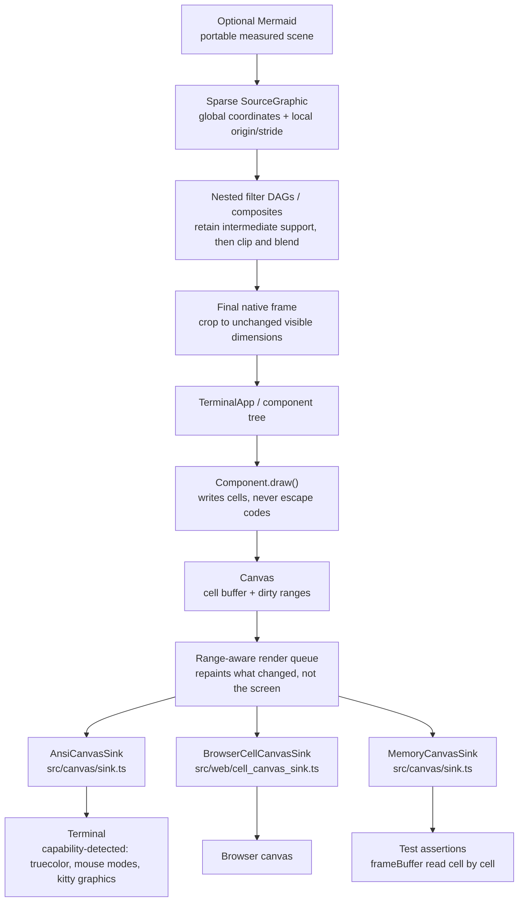
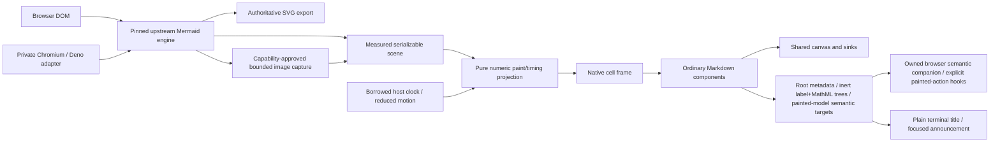

# Render pipeline

Final ink-ownership source passes complete browser/headless/53audited health gates on1468unchanged inputs;
API/package/release dry-run pass. Default bundle becomes899391bytes (+109), SHA
f3b2949624ac05e4a981c997c13696b827ac41610b3800f08e2555d502c8fcf6; consumer/downloads/private preview/owner plans remain
unchanged.600ink/3600repaint and15geometry/decoration profiles/390repaints/87172solid pixels plus48actual
disposed-MathML browser profiles/288frames guard the partition. Independent original pixels next prove radical-rule
thickness/center capture is wrong; all original full-standard requirements remain open. Earlier pending notes below are
historical revisions.

Browser cell ink now uses one finally-restored owned-plane clip, not cached advance-width overflow guesses. Device
pixels are partitioned at rounded cell boundaries (ceil-sized surface edges included); background clearing covers the
same plane. Font anchors stay in original logical coordinates; circuit/block geometry uses owned widths/heights so full
blocks leave no fractional seams. Wide owners still retain their two-cell span and incremental dirty followers. No
cell/frame/public API changes.600ink/3600repaint and15plane/390repaint/87172solid-pixel targeted checks pass; actual
disposed MathML document/remote integration adds48profiles/288frames. Final frozen broad verification follows. Default
bundle changes to899391bytes; consumer/downloads/private preview/owner plans remain unchanged. Every original
full-standard acceptance requirement remains open. Older next-gap notes below describe historical revisions.

Detached MathML marks now retain ready-font ink boxes separately from empty advance anchors. One bounded unregistered
font canvas serves accents/marks. Existing filter clip bounds plan automatic density across visible overhangs; actual
silhouette predicates select ink-owning cells. No free-cell search, clip exception, new frame/protocol/default import or
source text/style/link replacement. Unmeasured font/transform variants and exact outlines/shaping remain diagnosed.
32original before/after controls,32DOM/96snapshots and41actual656disposed frames pass targeted checks; the old carrier/
link assertion is unchanged. Complete browser/headless/53audited health gates/fonts/counters/types/lint/73focused/
package/release pass on1468unchanged inputs. Next an actual Canvas repro finds ink overhang left after owner-cell clear:
the sink checks advance width, not ink extent. All original task050 requirements remain open; default/consumers
unchanged.

Fraction rules now preserve original browser-resolved thickness/axis in existing scene affine stroke space. A lazy
bounded inert closed-shadow probe per math root borrows host fonts, snapshots font/math styles, uses known reference
rules and zero-stack baseline shifts, and is removed in finally on refusal/success. No source callbacks/styles/resources
or new protocol/default imports are installed. Ordinary token ink heights constrain automatic math density as well as
fences, preventing clipped denominator loss. ForeignObject viewports use their real affine geometry for clipping.
Fraction controls pass; the carrier correction above passes the old assertion without disabling clipping. Renew frozen
complete verification. Every original full-standard acceptance requirement and consumer integration remains open.

MathML operator capture preserves the original operator box and measured mirrored ink; parent/base boxes do not replace
actual nonzero ink extents. Native assembly uses rendered ink while logical text stays unchanged. Zero-advance accents
use styled font ink metrics at the original glyph origin, with one lazy unregistered1x1 measuring canvas per math root
and an explicit unresolved-metrics diagnostic. Unicode assembly/carrier projection is not exact font-outline or physical
OpenType-stretch evidence. Automatic row density preserves top/body/bottom fence cells within the same measured box, not
parent-height inflation. Original fence/accent pixels, the unchanged matrix oracles and disposed document transport
guard this seam. Complete browser/headless/53-gate health passes on frozen source; all original full-standard acceptance
requirements remain open, default/consumer artifacts unchanged. Authored fraction-rule thickness is independently proved
as the next fidelity gap, not inferred from a green catalogue.

The RTL-radical correction passes complete browser/headless/53-gate health, fonts/counters/types/lint/29narrow tests
on1467unchanged independently rediscovered inputs. Four original glyph controls retain U+221A ink;48DOM/144native
snapshots cover inherited/local directions and nested/indexed/fraction roots. Next ten pixel controls prove RTL
delimiter mirror loss and full-parent extents applied to nonstretch fallback glyphs. Fix measured operator ink/bounds;
default/consumer artifacts and public exports remain unchanged. Earlier receipts belong to their stated revisions.

Supports `../overview.md` — "renderer neutrality".

One component tree, three outputs. Components describe cells; nothing above the sink knows what a terminal is.

Horizontal unstretched MathML retains original glyph coordinates when reordered/mirrored, including implicit RTL under
LTR. Original line-box overlap prevents mistaking separate legacy rows for reversal and dropping logical spaces. Normal
math baselines/ink boxes and operator assemblies stay separate; existing inert sequences/scene budgets carry positions,
styles and links without protocol/default-import changes. Supported token warnings are scoped separately from unfinished
structural/stretch RTL; current Chromium's ignored vertical token CSS is not a native capability claim. Independent
geometry/baseline/style/link/disposed and complete browser/headless/53-gate health/701focused checks pass
on1467unchanged independently rediscovered inputs. RTL square/indexed roots now use measured right-side notation space
and put the overbar above the operand, not the index. Parent surds paint after base fraction rules to avoid quantized
boundary-cell replacement. Independent original pixels retain U+221A ink without inferred reflection. Broader math
font/structural/stretch fidelity and every original full-standard acceptance requirement remain open. Default/consumers
unchanged.

Scoped casing/MathML transport now preserves optional rendered ink and displaced fragments from measured MathML tokens.
Original token baselines and independent generated styles feed the existing native scene. A per-math-root map allocates
token sequences from the same scene-local text budget used by HTML/SVG, preventing cross-label density collisions and
rejecting aggregate character overflow. Ordinary casing warnings are emitted only when actual split labels require
missing glyph layout, not when optional layout is prepared. Complete browser/headless/53-gate health and701focused
checks pass on1467independently rediscovered unchanged inputs. Exact font/shaping, independently reproduced ordinary
MathML ordering and all ten full-standard acceptance requirements remain open; default/consumer artifacts are unchanged.

Final split-cluster browser/headless/53-gate health and701focused tests pass on1467unchanged independently rediscovered
inputs. Desktop/consumer artifacts are unchanged. This proves current fragment transport/collision guards, not the
remaining exact font/casing/feature/consumer/review requirements; all ten original task050 acceptance gates stay open.

Original scalar measurements can supply separate ink fragments inside one logical grapheme. HTML top-left/SVG center
anchors survive JSON; all positioned runs of a split label share one scene-local sequence. Native automatic density
checks visual row/column collisions across that label rather than source adjacency, retaining displaced marks and their
neighbors. Bounded fragment/ink/work validation precedes allocation. Indic/emoji/variation-selector shaping units stay
whole; printable carriers explicitly diagnose unresolved exact font shaping instead of claiming glyph-outline parity.

Complete browser/headless/53-gate verification passes for the HTML-affinity fallback. Advanced combining-cluster
measurements still need original-font/shaping evidence; neither defined caret geometry nor green transport gates imply
full Unicode/font fidelity.

HTML text uses original Range geometry and direct caret evidence first. Only ambiguous mirrored graphemes invoke a
cached, bounded text-only projection with neutral text-node splits. Separate rendered ink then travels in the existing
portable scene; neither original DOM nor later terminal/browser/remote consumers need the measuring document. Unknown or
font-only glyph capabilities remain diagnosed.

Filter references check original DOM tree order, actual SVG type and owned-root containment before portable graphs.
Fragment-only URLs ignore page base changes. Missing/wrong-type mixed references use bounded cached Canvas2D-measured
host policy; unknown capabilities are diagnosed and external/borrowed graphs stay denied. Invalid references cannot
bypass list/graph budgets; portable frames repaint after all measuring DOM is removed.

Filtered paint uses a sparse working grid separate from the visible frame. Global geometry and clipping retain their
original coordinates; an origin/stride encodes off-frame samples without negative-column key collisions. Conservative
graph and nested-group support retains offset/blur intermediates and primitive-generated paint until final viewport
cropping. Ordinary unfiltered rasterization stays clipped to the visible frame. Existing numeric, retained-cell and
scene-work guards bound the buffer without allocating a dense padded frame.

## What to notice

Current ordinary-SVG-anchor source passes both complete hosts, corrected53-gate health and font/counter/peer/package
checks on1467independently rediscovered unchanged inputs. Initial ANSI failures reproduce on the clean baseline under
NO_COLOR; a process-local color-enabled rerun passes without changing renderer code/assertions or borrowed preferences.
Default desktop/consumers are unchanged. Full-standard fidelity and review remain separate unfinished requirements.

Ordinary SVG mirror substitutions use renderedText without acquiring center-positioned glyph layout; genuine irregular
geometry keeps per-glyph rendered ink. Exact equal-bounds native/style/link comparisons at three densities guard the
reproduced one-row shift. Same-font/surface whole-SVG pixels match five advanced control samples exactly; a sixth has
two residual pixels, so broad normative-level/grapheme/shaping questions remain open.

Current bidi paint passes complete regression gates, but advanced caret affinity/embedding contexts remain
unproved:84level disagreements in an independent2000-case audit and inconclusive cropped font probes require stronger
original-context paint evidence. Do not equate paired substitution/position tests with full bidi/shaping.

Logical author text and rendered glyph ink are distinct portable fields. Browser-measured local SVG advance or
consistent HTML caret edges select paired Unicode mirrors; geometry transforms and paragraph direction alone do not.
Native/Markdown/JSON paint carries the selected ink without rewriting logical semantics. Unknown/ font-only cases retain
diagnostics and all existing paint/work bounds; broad shaping remains unfinished.

Current decoration-context/Kanban transport passes both complete hosts and all53health gates on unchanged frozen runtime
inputs. Those receipts prove this revision's checks, not every original full-standard feature or host capability; no
consumer is switched and the default desktop bundle is unchanged.

Range positions alone are not complete bidi glyph paint. The reproduced punctuation cases now use separate mirrored ink
while retaining logical text. Full embedding/isolate/shaping and ambiguous/font-only contexts remain required work.

Full-Mermaid Markdown/flex hosts project a horizontal offset over the unchanged portable frame. Offscreen Kanban ticket
ink is verified after panning in narrow views, including mounted SGR and exact left-view restoration; a zero-offset
viewport is not evidence that every original text run has lost its decoration.

Clip-bound metadata walks charge actual node/child/point work before traversal and reuse shared bounds within bounded
filter/envelope calls. Permanent read-count and pre-walk-budget controls supplement allocation/raster tests. Original
tree-scoped URL resolution is shared by filters and markers; missing local markers are no-ops, while valid borrowed or
external marker definitions remain denied. Browser pixels, not invented replacement arrows, define the measured output.

Decoration paint is selected for the rendered context, not the decorating ancestor's namespace. SVG text retains
decorating fill/stroke; HTML/CSS targets use captured CSS decoration color without inactive SVG paint. Per-extraction
owner/descriptor caches remain bounded by existing metadata limits and do not mutate mixed siblings. Original pixels and
exact pinned Kanban source establish black ticket underline ink; conventional terminal geometry is still not full CSS
decoration painting.

- **Documented extensions use their real upstream grammar.** ZenUML registers lazily once and validates through its
  exact core-generated grammar/runtime, not the plugin's no-op. Disposable module workers avoid its measured retained
  SDK Errors array; abort/disposal/timeout always terminate workers and revoke script URLs. Only ten successful sources
  are cached, not ASTs or rejected results. Its newly injected legacy viewer CSS is removed only on an exact pinned
  SHA-256 match; borrowed/same-sized host CSS and SVG-local style survive. No React viewer or DOM-global patch is
  needed.
- **Root SVG clipping follows the browser viewport.** Cleaned-up viewBox-free sibling probes retain meet letterboxes and
  CSS transforms after correcting root HTML-flow displacement. Intentionally clipped glyphs are rejected before native
  bounds diagnostics; upstream text and viewport dimensions are not rewritten to hide overflow.

- **Headless errors cross as diagnostics, not parser graphs.** An owned-page facade preserves bounded data-only
  name/message strings in fresh Errors without cyclic parse state, custom getters or coercion. Control escapes and
  explicit truncation make rejection visible; the next valid request still produces native cells.

- **Scalar widths come from the full pinned policy, not approximate blocks.** A compact assigned W/F projection and
  complete zero categories use the reviewed narrow profile with explicit RI/modifier tailoring. New wide symbols and
  supplementary scripts preserve complete followers; ambiguous/unassigned symbols stay narrow. Host-specific profiles,
  variation/font shaping and terminal capabilities remain unfinished.

- **Remote cell boundaries are explicit, not inferred from text.** Experimental generic codec v2 carries UTF-16 lengths
  including empty followers, with independent base/result integrity checks and bounded descriptor-only validation.
  Ready-handshake capability intersection selects v2; old peers use exact single-scalar v1 or reject required v2 before
  traffic. Frame flow owns immutable snapshots and bounded/coalesced queues. Raw ANSI/PTY and daemon protocols remain
  separate. Actual disposed Mermaid cells cross JSON full/delta before terminal and browser source/pixel oracles.

- **Grapheme boundaries share the pinned Unicode 17 profile.** Plain/styled text helpers, width/cropping and incremental
  nested terminal joins reuse the existing segmenter, with ASCII shortcuts only where boundaries are unambiguous. SGR
  inside a cluster retains the first scalar's cell style and updates following cells. Terminal width growth repairs
  followers/cursor/insert/REP/wrapping. A text-free boundary cursor and incremental width state preserve up to 65,536
  units per cell without growing-cluster rescans; shared extra-text accounting covers main/alternate/history, with
  visible whole-cluster refusal on exhaustion. Assigned zero-width categories use an offline-checked compact projection
  of the pinned width data, not a partial mark regex. Native wide-pair repair must inspect ASCII-base keycaps and later
  extending marks too. These limits do not bound all grid/style/decoder memory or establish full shaping, width policy
  or remote wire parity beyond the separately bounded negotiated cell codec.

- **The fork is at the sink, not in the components.** A widget that emits `\x1b[` directly has broken the property that
  makes the browser build and the headless tests possible.
- **ANSI is addressed cell transport, not plain concatenation.** Unicode cells are cursor-addressed on both sink paths;
  empty wide followers do not print or advance, and printable ASCII retains its compact spans. Cursor controls end
  leading-mark joins too. Raw text remains governed by its own Unicode boundaries. UTF-16 chunk decoding holds one high
  surrogate across writes/resize, with explicit EOF flushing; it is separate from grapheme-boundary state.
- **The test path is a first-class sink**, not a mock. What a test reads is what a terminal would have been sent, which
  is why a mounted test can catch a paint that never happened.
- **Pending updates survive dirty-region filtering.** A layout/visibility update can flag an object as moved without
  changing its rectangle. It still belongs in the required render set: a simultaneous resize may have cleared the whole
  frame while a disappearing object supplies a dirty region elsewhere. Skipping stationary rows in that case leaves
  clipped document panels blank. Canvas and mounted document tests assert actual cells across this sequence.
- **Capability detection lives below the sink.** Truecolor, mouse tracking modes and kitty graphics are negotiated with
  the terminal; components ask for a colour and get the best available representation.
- **Browser wide glyphs own atomic spans.** The browser retains staged source cells and repaints both columns whenever
  either half of an existing/new pair changes. Continuations are present cells with empty parsed text (TextObject may
  style them), not ordinary spaces or missing cells. A replaced owner clears its old tail; resize drops all span state.
  Glyphs/backgrounds/decorations cover both owned columns while oversized narrow-font advances remain clipped to one.
  Retained grids refuse nonfinite/over-2,000,000-cell allocation before mutating geometry. This does not repair the
  scalar-only version-1 remote limitations or prove exact CSS font geometry; negotiated v2 preserves explicit cells.

## Optional full Mermaid compilation

The browser DOM is a measuring/compiler capability, not the visible document host. Deno uses an isolated owned Chromium
context; native frames remain usable after that compiler is disposed. Core/document imports do not load this optional
engine or Playwright.

Rough hatch curves use bounded control-hull subdivision rather than uniform distance sampling. A detached owning-DOM
probe measures retained partial-curve lengths without mutating the source. Native centerline traversal keeps original
subpixel endpoints, exact cell-entry/exit intervals and measured tangent glyphs; snapping endpoints first shifted some
curves by a cell. This preserves the native safety limits and circuit composition, not pixel-exact SVG stroke outlines.

Source callbacks and resource policies stay host-controlled. Native fidelity diagnostics record unfinished advanced
paint, advanced image layout and unsupported animation rather than silently counting them as supported. Numeric paint
tracks are measured from mounted browser effects and restored transactionally; time changes reproject native cells, not
compiler jobs. Geometry/labels remain measured once, and borrowed clocks belong to the host. Captured RGBA images are
scene-owned portable assets, sampled through native affine/clip/compositor/work boundaries after the compiler is gone.
SVG image layout is captured per embedding viewport rather than assumed to be independent of placement. Host image
loaders are explicit; the private host shares approved response bytes and preflights PNG/JPEG HTTP dimensions. Embedded
data/blob decoding occurs earlier in upstream, so complete pre-decode image guarantees are still a separate gate.
Immediate document viewport snapshots refresh newly mounted rows until their reactive subscriptions settle; settled rows
keep normal incremental drawing.

Diagram root metadata travels with native scenes/frames/rows, not visible HTML overlays. Root-local references and
direct title/desc children exclude nested marker/icon names and unrelated host DOM IDs. The pinned engine's nine
common-preamble gaps have a bounded initial-only adapter; body grammar and layout remain upstream-owned, and returned
author source is unchanged. Markdown/flex semantic targets reuse painted models and solved widths, retain partially
visible diagrams and scope panel identities. Browser hosts explicitly update an owned hidden DOM companion on
viewport/source changes; description IDs remain owned and failure clears stale semantics. Generic app projections retain
graphics roles/fallback tokens. Terminals can announce plain title/description text, but cannot expose ARIA
relationships or structured roles. Root metadata transport does not establish full structured label/math/action
semantics or consumer/AT integration.

Keyboard action state belongs to each view, not a borrowed Markdown/flex measurement model. Painted span ranges create
navigation stops, with ordinary link identities preserved through wrapping and Mermaid IDs scoped to fences/panels.
Focus and bounded plain-text tooltip chrome paint through existing native Text rows/cell composition. Popup edge repair
removes either covered half of a wide glyph; popup content blocks click-through. Tab/global window modifiers stay
outside document navigation. Failed initial adapters release subscriptions; destroyed components cannot attach from
their queued mount microtask. Render cache stamps commit only after a successful frame, preventing failed retries from
returning stale action geometry.

Default upstream MathML labels are measured, not reparsed as TeX. Zero-size MathML baseline probes are restored in
finally blocks; node and layout-comparison caps bound their work. Native text items retain portable math density/stretch
hints, while fraction/radical rules use ordinary paths. Pure Unicode fence/accent assemblies share clip/compositor/work
boundaries and survive compiler disposal. Automatic row density preserves scripts and notation; explicit host overrides
warn if they can merge rows. Source phantom/annotation content remains hidden. This is structural cell projection, not
full MathML font-outline/legacy HTML parity.

CSS-generated label text is captured before native and semantic traversal share the mounted source. Bounded resolved
string lists/attr() values become temporary plain-text boxes with non-resource computed styles. Hidden staging checks
pseudo suppression before display, element/text-range fidelity prevents accepting changed source layout, and all
probes/attributes/styles are removed on success, refusal or exceptions. Native MathML keeps separate measured generated
rows and styled fragments; the source browser still owns layout/casing. Counter/quote-keyword/image/alternative content
and box effects report unfinished capabilities rather than silently disappearing. No arbitrary CSS is transported into
the semantic companion, and this temporary measurement path is not a visible document overlay.

Geometric SVG clips are measured in the same normalized coordinates as their items. Shapes union within a clip; ancestor
clips and nested viewport overflow intersect. The serializable tree stays attached to ordinary flat scene items, so no
browser clipping overlay is needed. Native cell predicates validate tree/point/depth limits, charge the scene-work
budget and share bounded caches. Fill cells sample their centres; text/strokes sample their positions, and wide glyphs
are admitted only as a whole. CSS/text/use clipping, masks, advanced filters and patterns remain explicit gaps.

Wide strokes retain authored affine metrics separately from scene centerlines. Bounded dash runs supply segment bodies,
caps and joins; their sampled union paints once through the existing clip/gradient/compositor/action boundary,
preventing overlap alpha inflation. Closed seams and disconnected phase resets remain contour-owned. Thin circuit glyphs
preserve the terminal minimum footprint, while wide silhouettes use ordinary full-block foreground cells. No DOM
geometry API is needed after capture/JSON transfer; source/dash-run/frame/scene-work bounds remain explicit. Non-scaling
strokes retain scene-to-host metrics and separate stroke-only contour distances, preserving original local distance and
pathLength calibration. Computed shape paint order may split a path around expanded marker items; source owners keep
shared opacity/filter/blend ranges, and numeric animation tracks target the correct split indices. Non-scaling
strokeWidth markers preserve measured Chromium RMS-CTM normalization. Arc joins, text-outline paint order and full
curve-outline/advanced animation evidence remain open.

The native text pass uses bounded measured grapheme centers for rotated/reflected/vertical/path labels, including source
style ownership and inert scene-local sequences for cross-run density. Source character APIs use UTF-16 indices;
portable offsets must respect complete native graphemes. Axis-aligned bounds use all four transformed corners, not
signed diagonal differences. Terminal glyphs stay upright; automatic density prevents adjacent cell collisions without
letting a rotated label's narrow extent govern all columns. Text/node/refinement/frame budgets remain bounded and
borrowed DOM is untouched. This is not complete shaping, text transforms/bidi or glyph-outline paint.

Scene items retain RGBA/fill/stroke opacity, local gradient samplers and half-open nested compositing ranges. The pure
native pass paints sparse isolated layers in document order, then composites each group once over its parent using
opacity and the standard blend function. Layer nesting, retained cells and sampling work are bounded. Gradient color and
stop opacity interpolate separately, as SVG requires; modern colors reuse the existing theme Oklab converters. Only the
final cell projection serializes colors, optionally flattened against an explicit opaque host backdrop. Prepared
Markdown supplies ordinary RGB styles and diagnoses its black default if no backdrop was supplied. Unpainted cells
remain unstyled; opaque overlays clear hidden glyph/link state, and wide-glyph repair removes both halves if either is
occluded. This is cell-scale paint, not a pixel-perfect font compositor or full advanced SVG parity.

Filtered elements also own composite ranges. Their SourceGraphic stops inheriting clip constraints at that boundary; the
completed filter result receives the deferred element/ancestor clip before opacity and blend. Portable filter nodes
reference earlier numbered results, including SourceGraphic/SourceAlpha and named SVG intermediates. Pure native
operators process background/visible-color planes and native glyph metadata, releasing intermediate maps at their last
consumer. Photometric filters change colors without rasterizing labels; blur/offset/shadow use premultiplied cell-scale
samples and unlinked halos. Measured regions bound flood/spatial work; graph/table/kernel/intermediate budgets and the
shared work charge prevent unbounded scene processing. CSS functions use sRGB, SVG primitives retain their measured
space, and linearRGB intermediates follow observed 8-bit browser surfaces with identity paths preserving dark colors.
Advanced primitives, covariance kernels and off-frame source buffering remain diagnosed; no full filter parity claim.

Local SVG use instances are expanded at their original paint position. Style-only shadow roots share already-readable
stylesheets and inherit the use host's computed values; source/destination ancestors cannot pierce the scope. Capture
all descendant styles before modifying any node, retain Typed OM percentage transforms, then measure mounted native SVG
geometry. Symbol/SVG viewport sizing uses browser probes rather than assuming CSS and SVG attributes are equivalent.
Recursive ranges inherit clips and links without duplicating outer opacity. Shared reference/node/instance/style bounds
reject excess, with batch preflight before repeated measurement and finally-cleaned probes. External/cyclic references
and unavailable style capabilities are diagnosed. Visible output remains ordinary native cells, not the probe DOM.
